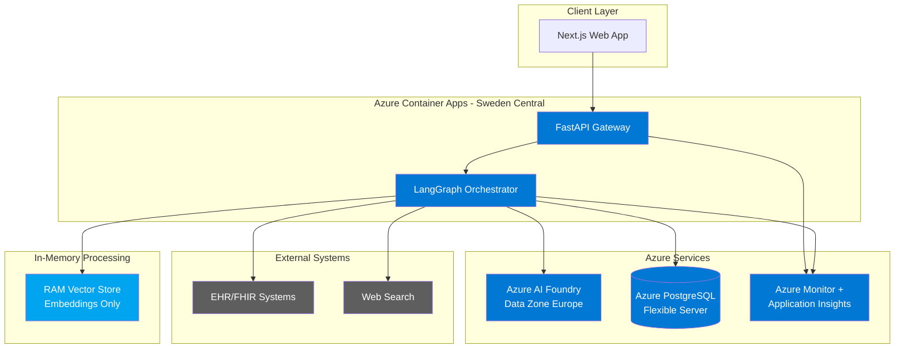
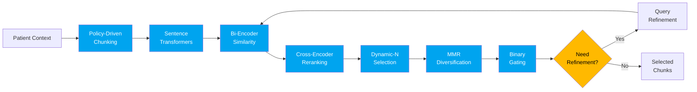
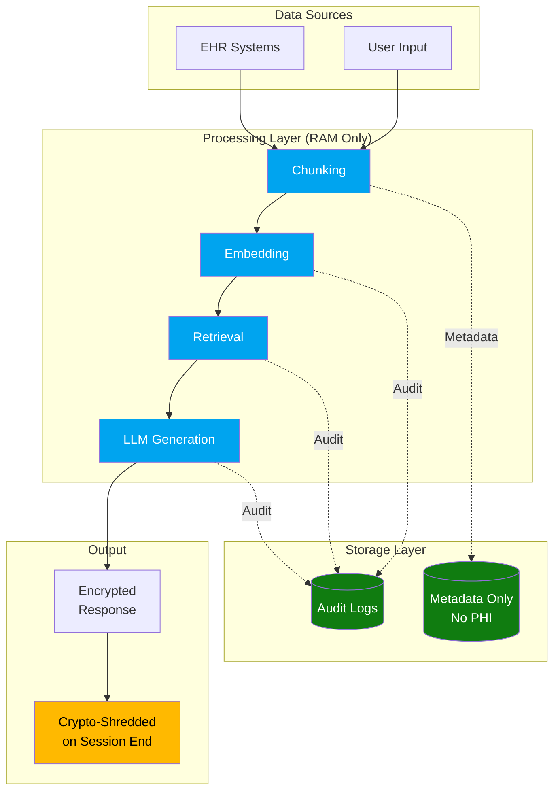

# OptiMed (CLARA) - Clinical AI Research Assistant

**CLARA** (Clinical Language AI Research Assistant) is an advanced medical AI platform designed to assist healthcare professionals with clinical information retrieval, patient data analysis, and documentation generation while maintaining strict GDPR compliance and patient privacy.

[](https://azure.microsoft.com/en-us/products/container-apps/)
[](https://azure.microsoft.com/en-us/products/ai-services/)
[](https://azure.microsoft.com/en-us/explore/global-infrastructure/geographies/#geographies)
[](https://gdpr.eu/)
[](https://www.python.org/)
[](https://www.typescriptlang.org/)

---

## 🌟 Key Features

### 🔬 Advanced Clinical Information Retrieval
- **Multilingual Support**: Cross-encoder reranking with 100+ language support
- **RAM-Only Processing**: Zero PHI persistence - all embeddings live only in memory
- **9-Stage Retrieval Pipeline**: Bi-encoder → Cross-encoder → MMR → Gating → Agentic refinement
- **Sub-Second Response Times**: Optimized parallel execution for clinical workflows

### 🏥 Specialized Clinical Flows
- **SBAR Handoffs**: Structured clinical handoff communication (Situation-Background-Assessment-Recommendation)
- **Comprehensive Summaries**: 8-component patient overview (Snapshot, Problems, Meds, Trends, History, Risks, Encounters, Deep-dive)
- **Timeline Visualization**: Chronological patient journey with key clinical events
- **Clinical Documentation**: Template-driven note generation (SOAP, Progress, Admission, Discharge)

### 🔒 Privacy & Compliance First
- **GDPR Compliant**: Data Zone Europe deployment (Sweden Central)
- **EU Data Residency**: All data processing within EU boundaries
- **End-to-End Encryption**: AES-256-GCM with session-based keys
- **Complete Audit Trail**: Comprehensive logging for regulatory compliance
- **No PHI Persistence**: Patient data never stored in databases

### 🚀 Enterprise-Grade Infrastructure
- **Azure Container Apps**: Scalable, serverless deployment
- **Azure AI Foundry**: Enterprise LLM services (Data Zone Europe)
- **Azure PostgreSQL**: Flexible Server with GDPR-safe schema
- **Azure Monitor**: Comprehensive observability and alerting

---

## 🏗️ Architecture

### System Overview



### Retrieval Pipeline



### Data Flow (GDPR-Compliant)



---

## 🚀 Quick Start

### Prerequisites

- **Azure Account** with active subscription
- **Python 3.12+** with pip
- **Node.js 18+** with npm
- **Azure CLI** installed and configured
- **Git** for version control

### Local Development Setup

#### 1. Clone Repository

```bash
git clone https://github.com/your-org/optimed.git
cd optimed
```

#### 2. Backend Setup

```bash
# Create and activate conda environment
conda env create -f environment.yml
conda activate optimed

# Or use pip directly
pip install -r requirements.txt

# Set up environment variables
cp .env.example .env
# Edit .env with your Azure configuration
```

#### 3. Database Setup

```bash
# Local PostgreSQL with pgvector
createdb optimed_dev

# Run migrations
python scripts/run_migrations.py
```

#### 4. Frontend Setup

```bash
cd src/optimed/apps/web
npm install
```

#### 5. Run Development Servers

```bash
# Terminal 1: Backend
python -m uvicorn optimed.apps.api_gateway.main:app --reload --host 0.0.0.0 --port 8000

# Terminal 2: Frontend
cd src/optimed/apps/web
npm run dev
```

Access the application at `http://localhost:3000`

---

## ☁️ Azure Deployment

### Production Deployment to Sweden Central

#### 1. Prerequisites

```bash
# Login to Azure
az login

# Set subscription
az account set --subscription "your-subscription-id"

# Create resource group
az group create --name optimed-sweden-rg --location swedencentral
```

#### 2. Deploy Azure AI Foundry (Data Zone Europe)

```bash
# Create Azure OpenAI resource
az cognitiveservices account create \
  --name optimed-ai-sweden \
  --resource-group optimed-sweden-rg \
  --location swedencentral \
  --kind OpenAI \
  --sku S0

# Deploy GPT-4o model
az cognitiveservices account deployment create \
  --resource-group optimed-sweden-rg \
  --name optimed-ai-sweden \
  --deployment-name gpt-4o \
  --model-name gpt-4o \
  --model-version "2024-08-06" \
  --sku-capacity 50
```

See [Azure AI Foundry Setup Guide](docs/operations/azure_ai_foundry_setup.md) for detailed configuration.

#### 3. Deploy Azure PostgreSQL

```bash
# Create PostgreSQL Flexible Server
az postgres flexible-server create \
  --name optimed-db-sweden \
  --resource-group optimed-sweden-rg \
  --location swedencentral \
  --admin-user optimed_admin \
  --admin-password <secure-password> \
  --sku-name Standard_D2s_v3 \
  --tier GeneralPurpose \
  --version 17

# Enable required extensions
az postgres flexible-server parameter set \
  --resource-group optimed-sweden-rg \
  --server-name optimed-db-sweden \
  --name azure.extensions \
  --value "pgcrypto,vector"
```

See [Azure PostgreSQL Setup Guide](docs/operations/azure_postgresql_setup.md) for detailed configuration.

#### 4. Deploy Container Apps

```bash
# Create Container Apps Environment
az containerapp env create \
  --name optimed-env-sweden \
  --resource-group optimed-sweden-rg \
  --location swedencentral

# Build and push backend image
az acr build --registry optimedacr123 \
  --image optimed-api-sweden:latest \
  --file Dockerfile.backend .

# Deploy backend container
az containerapp create \
  --name optimed-api-sweden \
  --resource-group optimed-sweden-rg \
  --environment optimed-env-sweden \
  --image optimedacr123.azurecr.io/optimed-api-sweden:latest \
  --target-port 8000 \
  --ingress external \
  --min-replicas 1 \
  --max-replicas 5 \
  --cpu 1.0 \
  --memory 2Gi

# Deploy frontend container
az containerapp create \
  --name optimed-web-sweden \
  --resource-group optimed-sweden-rg \
  --environment optimed-env-sweden \
  --image optimedacr123.azurecr.io/optimed-web-sweden:latest \
  --target-port 3000 \
  --ingress external \
  --min-replicas 1 \
  --max-replicas 3
```

See [Deployment Process Guide](docs/operations/deployment_process.md) for complete deployment instructions.

---

## 📖 Documentation

### Getting Started
- [Introduction](docs/overview/introduction.md) - System overview and capabilities
- [Setup Guide](docs/operations/setup_guide.md) - Local development environment
- [Deployment Process](docs/operations/deployment_process.md) - Azure deployment guide

### Architecture
- [System Architecture](docs/architecture/system_architecture.md) - High-level system design
- [Data Flow](docs/architecture/data_flow.md) - Data processing pipeline
- [Hexagonal Architecture](docs/architecture/hexagonal_architecture.md) - Domain-driven design
- [GDPR Compliance](docs/architecture/gdpr_compliant_architecture.md) - Privacy-preserving architecture

### Algorithms
- [Intelligent Retrieval](docs/algorithms/intelligent_retrieve_chunks.md) - 9-stage retrieval pipeline
- [Specialized Flows](docs/algorithms/specialized_flows.md) - SBAR, summaries, timelines, notes
- [Info Flow](docs/algorithms/info_flow_langgraph.md) - LangGraph orchestration
- [Patient Flow](docs/algorithms/patient_flow_langgraph.md) - Patient context processing

### Operations
- [Azure AI Foundry Setup](docs/operations/azure_ai_foundry_setup.md) - LLM configuration
- [Azure PostgreSQL Setup](docs/operations/azure_postgresql_setup.md) - Database configuration
- [Monitoring](docs/operations/monitoring.md) - Azure Monitor and Application Insights
- [GDPR Operational Guide](docs/operations/gdpr_operational_guide.md) - Compliance operations

### Specifications
- [API Specification](docs/specs/api_specification.md) - REST API endpoints
- [Database Schema](docs/specs/database_schema.md) - GDPR-safe database design
- [Component Details](docs/specs/component_details.md) - Technical component specifications

### Security & Compliance
- [Encryption Architecture](docs/security/encryption_architecture.md) - E2E encryption design
- [Data Traceability](docs/compliance/data_traceability_guide.md) - Audit and lineage tracking

---

## 🧪 Testing

```bash
# Run all tests
pytest

# Run with coverage
pytest --cov=optimed --cov-report=html

# Run specific test file
pytest tests/test_retrieval.py

# Run with verbose output
pytest -v
```

---

## 🛠️ Development

### Project Structure

```
optimed/
├── src/optimed/
│   ├── adapters/              # External integrations
│   │   ├── anthropic_claude/  # Claude AI adapter
│   │   ├── openai_gpt/        # Azure OpenAI adapter
│   │   ├── fhir_hapi/         # FHIR server integration
│   │   ├── smart_fhir/        # SMART-on-FHIR
│   │   ├── security/          # E2E encryption
│   │   └── vectorstores/      # RAM vector store
│   ├── apps/
│   │   ├── api_gateway/       # FastAPI application
│   │   ├── orchestrator/      # LangGraph flows
│   │   └── web/               # Next.js frontend
│   ├── core/
│   │   ├── domain/            # Domain entities
│   │   └── ports.py           # Abstract interfaces
│   └── embeddings/            # Sentence transformers
├── docs/                      # Documentation
├── migrations/                # Database migrations
├── scripts/                   # Utility scripts
├── tests/                     # Test suite
├── Dockerfile.backend         # Backend container
├── requirements.txt           # Python dependencies
└── environment.yml            # Conda environment
```

### Key Technologies

**Backend:**
- FastAPI (Python 3.12)
- LangGraph (Orchestration)
- Azure OpenAI SDK
- Sentence-Transformers
- asyncpg (PostgreSQL)
- Pydantic (Validation)

**Frontend:**
- Next.js 15 (React)
- TypeScript
- Tailwind CSS
- Radix UI Components
- Server-Sent Events (Streaming)

**Infrastructure:**
- Azure Container Apps
- Azure PostgreSQL Flexible Server
- Azure AI Foundry (Data Zone Europe)
- Azure Monitor + Application Insights
- Azure Container Registry

**ML/AI:**
- Azure OpenAI (GPT-4o)
- Sentence-Transformers (MiniLM)
- Multilingual Cross-Encoder
- Zero-Shot Classifier

---

## 🔐 Security & Privacy

### GDPR Compliance

OptiMed implements privacy-by-design principles:

- ✅ **Data Minimization**: Only metadata stored, never PHI
- ✅ **Purpose Limitation**: Each session tracks lawful basis
- ✅ **Data Subject Rights**: Automated handling of access, erasure, portability
- ✅ **Security**: End-to-end encryption, audit logging, crypto-shredding
- ✅ **Transparency**: Complete data lineage tracking
- ✅ **Accountability**: Comprehensive compliance monitoring

### Data Residency

- **Primary Region**: Sweden Central (EU)
- **Failover**: North Europe (EU)
- **Data Processing**: 100% within EU boundaries
- **LLM Provider**: Azure AI Foundry Data Zone Europe
- **Database**: Azure PostgreSQL in Sweden Central

### Security Features

- **Encryption at Rest**: AES-256-GCM
- **Encryption in Transit**: TLS 1.3
- **Session Encryption**: Fernet with RSA-2048 key exchange
- **Authentication**: OAuth2/OIDC + SMART-on-FHIR
- **Audit Logging**: All data access logged for 7 years
- **Row-Level Security**: Multi-tenant data isolation

---

## 📊 Performance

### Retrieval Performance

| Operation | Latency | Throughput |
|-----------|---------|------------|
| Bi-Encoder Similarity | 100-200μs/chunk | 5K-10K chunks/sec |
| Cross-Encoder Reranking | 10-50ms/batch | 100-300 chunks/sec |
| MMR Diversification | 1-5ms | 1K selections/sec |
| Full Retrieval Pipeline | 300-800ms | 50-100 retrievals/sec |

### Specialized Flows

| Flow Type | Components | Total Time | First Token |
|-----------|------------|------------|-------------|
| SBAR | 4 parallel | 300-500ms | <1s |
| General Summary | 8 parallel | 500-800ms | <1s |
| Timeline | 8-12 events | 800-1200ms | <1.5s |
| Note Generation | 4-6 sections | 600-1000ms | <1s |

### Scalability

- **Concurrent Sessions**: 100+ per backend replica
- **Memory per Session**: 1-2MB
- **Auto-scaling**: 1-5 replicas based on load
- **Database Connections**: Pooled, 20 connections per replica

---

## 🤝 Contributing

We welcome contributions! Please see our contributing guidelines:

1. **Fork** the repository
2. **Create** a feature branch (`git checkout -b feature/amazing-feature`)
3. **Commit** your changes (`git commit -m 'Add amazing feature'`)
4. **Push** to the branch (`git push origin feature/amazing-feature`)
5. **Open** a Pull Request

### Development Guidelines

- Follow PEP 8 for Python code
- Use TypeScript for frontend code
- Write tests for new features
- Update documentation
- Ensure GDPR compliance for any data handling

---

## 📝 License

This project is proprietary software. All rights reserved.

For licensing inquiries, contact: [contact@optimedai.com](mailto:contact@optimedai.com)

---

## 📞 Support

- **Documentation**: [https://docs.optimedai.com](https://docs.optimedai.com)
- **Issues**: [GitHub Issues](https://github.com/your-org/optimed/issues)
- **Email**: [support@optimedai.com](mailto:support@optimedai.com)

---

## 🙏 Acknowledgments

Built with:
- [Azure AI Services](https://azure.microsoft.com/en-us/products/ai-services/)
- [LangGraph](https://github.com/langchain-ai/langgraph)
- [FastAPI](https://fastapi.tiangolo.com/)
- [Next.js](https://nextjs.org/)
- [Sentence-Transformers](https://www.sbert.net/)

---

**Made with ❤️ for healthcare professionals | Deployed in 🇸🇪 Sweden Central | GDPR ✅ Compliant**
