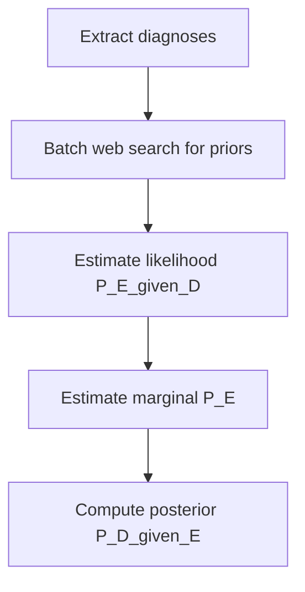

## Executive Summary
`patient_flow.py` computes differential diagnosis confidence using Bayesian inference with batched priors, evidence likelihood estimation, and a consistent marginal probability calculation.

## Algorithm Overview
1) Extract diagnoses from model output (no confidence yet).
2) Batch-retrieve prior probabilities via web search (epidemiology/prevalence).
3) For each diagnosis, estimate likelihood P(Evidence|Diagnosis) from patient context (vitals, labs, meds, notes).
4) Estimate marginal probability P(Evidence) using law of total probability over the same candidate set and priors.
5) Compute posterior P(Diagnosis|Evidence) = (Likelihood × Prior) / Marginal; clamp to [0,1].

## Key Functions (from `patient_flow.py`)
- `_batch_web_search_for_priors(diagnoses, patient_context) -> dict[str, float]`
- `_calculate_likelihood(diagnosis_name, patient_context, supporting_evidence) -> float`
- `_estimate_marginal_probability_with_batch_priors(patient_context, supporting_evidence, batch_priors) -> float`
- `_calculate_bayesian_confidence_with_batch_priors(...) -> float`

### Priors
- Derived from epidemiology/prevalence via a single combined query for consistency.
- Stored in `batch_priors` and reused across all diagnoses.

### Likelihood
- Uses sensitivity/specificity estimation for the evidence pattern to approximate P(E|D).
- Falls back to moderate defaults if parsing fails.

### Marginal Probability
- Applies law of total probability using the SAME priors across candidates:
  P(E) ≈ Σ_i P(E|D_i) × P(D_i) + baseline_other

### Posterior
- P(D|E) = (P(E|D) × P(D)) / P(E); safe-guarded against division by zero; result clamped to [0,1].

## Stakeholder Notes
- This provides transparent, auditable confidence scores. It is an assistive estimate and not a clinical diagnosis.

