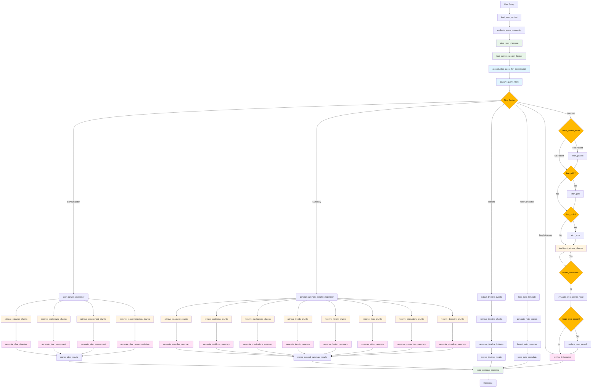

## Executive Summary

The information flow (`info_flow_ram.py`) orchestrates clinical information retrieval using LangGraph state machine architecture. The flow supports standard queries, specialized flows (SBAR, General Summary, Timeline, Note Generation), and implements RAM-only processing with zero PHI persistence.

**Key Features**:
- Query intent classification for optimized routing
- Specialized clinical flows with parallel execution
- RAM-only session memory with encryption
- Agentic retrieval refinement
- GDPR-compliant audit logging

---

## Complete Flow Diagram



---

## Node Descriptions

### Entry Nodes

#### `load_user_context`
**Purpose**: Load authenticated user information from session

**Implementation**:
```python
async def load_user_context(state: FlowState) -> FlowState:
    """Load user context from session."""
    if state.user_id:
        user = await user_repo.get_user_by_id(state.user_id)
        state.user_context = user
    return state
```

**Outputs**:
- `state.user_context`: User object with role, permissions, EHR connections

---

#### `evaluate_query_complexity`
**Purpose**: Determine if query requires full processing or simple lookup

**Classification Logic**:
```python
async def evaluate_query_complexity(state: FlowState) -> FlowState:
    """Classify query as simple lookup or complex processing."""

    # Simple patterns that don't need full processing
    simple_patterns = [
        r"^\s*hello\s*$",
        r"^\s*hi\s*$",
        r"^\s*help\s*$",
        r"^\s*what can you do\s*\??\s*$"
    ]

    query_lower = state.user_prompt.lower().strip()

    for pattern in simple_patterns:
        if re.match(pattern, query_lower):
            state.requires_full_processing = False
            return state

    # Default: require full processing
    state.requires_full_processing = True
    return state
```

**Routing**:
- `requires_full_processing = False`: Skip directly to `provide_information`
- `requires_full_processing = True`: Continue through classification pipeline

---

### Session Management Nodes

#### `store_user_message`
**Purpose**: Store encrypted user message in ephemeral RAM-only session memory

**Implementation**:
```python
async def store_user_message(state: FlowState) -> FlowState:
    """Store user message with E2E encryption in RAM."""

    if state.session_id:
        msg = ChatMessage(
            role=ChatRole.USER,
            content=state.user_prompt,
            timestamp=datetime.now(timezone.utc)
        )

        # Encrypt message content
        encryption_manager = get_session_encryption_manager(state.session_id)
        if encryption_manager:
            encrypted_content = encryption_manager.encrypt(msg.content)
            msg.content = encrypted_content

        # Store in global RAM-only session memory
        _GLOBAL_SESSION_MEMORY.setdefault(state.session_id, [])
        _GLOBAL_SESSION_MEMORY[state.session_id].append({
            "role": msg.role.value,
            "content": msg.content,
            "timestamp": msg.timestamp.isoformat()
        })

        # Log GDPR-safe metrics (no PHI)
        await user_repo.log_system_usage_metric(
            metric_type="session_activity",
            metric_name="user_message_stored",
            value=1,
            dimensions={"session_id_hash": hash(state.session_id)}
        )

    return state
```

**Key Features**:
- ✅ RAM-only storage (no database persistence)
- ✅ E2E encryption with session keys
- ✅ Automatic crypto-shredding on session end
- ✅ GDPR-safe metrics logging

---

#### `load_current_session_history`
**Purpose**: Load and decrypt conversation history from RAM

**Implementation**:
```python
async def load_current_session_history(state: FlowState) -> FlowState:
    """Load session history from in-memory store with decryption."""

    if state.session_id:
        history = _GLOBAL_SESSION_MEMORY.get(state.session_id, [])

        # Decrypt messages
        encryption_manager = get_session_encryption_manager(state.session_id)
        decrypted_history = []

        for msg in history:
            content = msg["content"]
            if encryption_manager:
                try:
                    content = encryption_manager.decrypt(content)
                except Exception:
                    # Skip corrupted messages
                    continue

            decrypted_history.append(ChatMessage(
                role=ChatRole(msg["role"]),
                content=content,
                timestamp=datetime.fromisoformat(msg["timestamp"])
            ))

        # Deduplicate and sort
        state.chat_history = sorted(
            set(decrypted_history),
            key=lambda x: x.timestamp
        )[-20:]  # Keep last 20 messages

    return state
```

---

### Classification Nodes

#### `contextualize_query_for_classification`
**Purpose**: Add conversation context to query for better intent classification

**Implementation**:
```python
async def contextualize_query_for_classification(state: FlowState) -> FlowState:
    """Use LLM to add context to query for classification."""

    if not state.chat_history:
        state.classification_query = state.user_prompt
        return state

    # Build context from recent history
    recent_context = "\n".join([
        f"{msg.role.value}: {msg.content[:200]}"
        for msg in state.chat_history[-3:]
    ])

    prompt = f"""Given this conversation history and the user's latest query,
create a single reformulated query that includes necessary context for intent classification.

Conversation History:
{recent_context}

Latest Query: {state.user_prompt}

Return only the reformulated query (no explanation).
"""

    response = await llm.chat([
        ChatMessage(role=ChatRole.SYSTEM, content="You reformulate queries to include context."),
        ChatMessage(role=ChatRole.USER, content=prompt)
    ])

    state.classification_query = response.content.strip()
    return state
```

**Example**:
- **Original Query**: "What about blood pressure?"
- **Context**: Previous question was "Show me the patient's vitals"
- **Contextualized**: "Show me the patient's blood pressure vitals"

---

#### `classify_query_intent`
**Purpose**: Classify query intent using zero-shot classification

**Implementation**:
```python
async def classify_query_intent(state: FlowState) -> FlowState:
    """Classify query using zero-shot classifier."""

    query = getattr(state, 'classification_query', state.user_prompt)

    label = zero_shot_classifier.classify_query(query, [
        "lookup",      # Simple fact retrieval
        "reasoning",   # Complex analysis
        "comparative", # Comparison tasks
        "guideline",   # Evidence-based guidelines
        "handoff",     # SBAR clinical handoff
        "summary"      # General patient summary
    ])

    state.query_classification = label

    # Set specialized flow flags
    if label == "handoff":
        state.is_sbar_flow = True
    elif label == "summary":
        state.is_general_summary_flow = True

    return state
```

**Classification Categories**:

| Label | Description | Example Query | Flow Route |
|-------|-------------|---------------|------------|
| `lookup` | Simple fact | "What is patient's BP?" | Standard (fast) |
| `reasoning` | Complex analysis | "Explain diabetes management" | Standard (detailed) |
| `comparative` | Comparison | "Compare BP over time" | Standard (analytical) |
| `guideline` | Evidence-based | "Guidelines for HTN treatment" | Standard + Web Search |
| `handoff` | Clinical handoff | "Prepare handoff summary" | SBAR Flow |
| `summary` | Patient overview | "Summarize patient status" | General Summary Flow |

---

### Flow Routing

#### Routing Logic

```python
def route_after_classification(state: FlowState) -> str:
    """Route to appropriate flow based on classification."""

    # Check specialized flows first
    if state.is_sbar_flow:
        return "sbar_parallel_dispatcher"

    if state.is_general_summary_flow:
        return "general_summary_parallel_dispatcher"

    if state.is_timeline_flow:
        return "extract_timeline_events"

    if state.is_note_generation_flow:
        return "load_note_template"

    # Standard flow
    if not state.requires_full_processing:
        return "provide_information"

    return "check_patient_exists"
```

---

## Specialized Flows

### SBAR Flow (Clinical Handoff)

**Entry**: `sbar_parallel_dispatcher`

**Parallel Execution**:
```python
async def sbar_parallel_dispatcher(state: FlowState) -> FlowState:
    """Dispatch 4 SBAR components in parallel."""

    # All 4 components execute simultaneously
    # Coordinator waits for all to complete
    # Each component:
    #   1. Retrieves focused chunks (fast bi-encoder only)
    #   2. Generates component text (LLM with specific prompt)

    return state  # Components update state independently
```

**Components**:
1. **Situation** → `retrieve_situation_chunks` → `generate_sbar_situation`
2. **Background** → `retrieve_background_chunks` → `generate_sbar_background`
3. **Assessment** → `retrieve_assessment_chunks` → `generate_sbar_assessment`
4. **Recommendation** → `retrieve_recommendation_chunks` → `generate_sbar_recommendation`

**Merge**: `merge_sbar_results`

**Performance**: ~300-500ms total (parallel execution)

---

### General Summary Flow

**Entry**: `general_summary_parallel_dispatcher`

**Parallel Execution**: 8 components execute simultaneously

**Components**:
1. **Snapshot** → Current status
2. **Problems** → Active/historical problems
3. **Medications** → Current medications
4. **Trends** → Clinical trajectory
5. **History** → Medical background
6. **Risks** → Risk factors
7. **Encounters** → Recent visits
8. **Deep-dive** → Query-specific analysis

**Merge**: `merge_general_summary_results`

**Performance**: ~500-800ms total (parallel execution)

---

### Standard Flow Nodes

#### `fetch_patient`
**Purpose**: Retrieve patient data from EHR via FHIR

**Implementation**:
```python
async def fetch_patient(state: FlowState) -> FlowState:
    """Fetch patient data from EHR system."""

    # Try user's EHR connection first (SMART-on-FHIR)
    if state.user_context and state.user_context.ehr_connections:
        fhir_repo = get_user_fhir_repository(state.user_context)
    else:
        fhir_repo = default_fhir_repository

    # Fetch patient bundle
    patient_ctx = await fhir_repo.get_patient_context(state.patient_id)
    state.patient_ctx = patient_ctx

    # Log data access for GDPR compliance
    await audit_repo.log_data_access(
        session_id=state.session_id,
        user_id=state.user_id,
        patient_id=state.patient_id,
        data_source="fhir_server",
        resource_types=["Patient", "Observation", "Condition", ...],
        lawful_basis="treatment",
        purpose="clinical_information_retrieval"
    )

    return state
```

---

#### `intelligent_retrieve_chunks`
**Purpose**: 9-stage retrieval pipeline (see [intelligent_retrieve_chunks.md](intelligent_retrieve_chunks.md))

**Stages**:
1. Policy-driven chunking
2. Sentence-transformer embedding
3. Query paraphrasing
4. Bi-encoder scoring
5. Cross-encoder reranking
6. Dynamic-N selection
7. MMR diversification
8. Binary gating
9. Agentic refinement loop

**Refinement Loop**:
```python
def needs_refinement(state: FlowState) -> bool:
    """Check if retrieval needs refinement."""
    return (
        state.needs_refinement and
        state.retrieval_retry_attempts < RETRY_MAX
    )

# LangGraph routing
_builder.add_conditional_edges(
    "intelligent_retrieve_chunks",
    needs_refinement,
    {
        True: "intelligent_retrieve_chunks",  # Loop back
        False: "evaluate_web_search_need"      # Continue
    }
)
```

---

#### `evaluate_web_search_need`
**Purpose**: Determine if web search is needed for current query

**Logic**:
```python
async def evaluate_web_search_need(state: FlowState) -> FlowState:
    """Decide if web search is needed."""

    classification = state.query_classification

    # Force web search for factoid questions needing credible sources
    factoid_classes = ["guideline", "reasoning", "comparative"]
    if classification in factoid_classes:
        state.web_search_performed = True
        return state

    # Otherwise, use LLM to decide
    prompt = f"""Does this query require web search for current guidelines/evidence?

Query: {state.user_prompt}
Context Available: {len(state.retrieved_chunks)} chunks

Return JSON: {{"needs_web_search": true/false, "reasoning": "..."}}
"""

    response = await llm.chat([...])
    result = parse_json(response)

    state.web_search_performed = result["needs_web_search"]
    return state
```

---

#### `perform_web_search`
**Purpose**: Execute web search using Tavily API

**Implementation**:
```python
async def perform_web_search(state: FlowState) -> FlowState:
    """Perform web search for additional context."""

    search_response = await web_search_service.search(
        query=state.user_prompt,
        max_results=5,
        search_depth="advanced"
    )

    state.web_search_response = search_response
    state.retrieved_web = [
        f"**{result.title}**\n{result.content}\nSource: {result.url}"
        for result in search_response.results
    ]

    return state
```

---

#### `provide_information`
**Purpose**: Generate final LLM response with all retrieved context

**Implementation**:
```python
async def provide_information(state: FlowState) -> FlowState:
    """Generate information response using LLM."""

    # Build context from all sources
    context_parts = []

    # Clinical chunks
    if state.retrieved_chunks:
        context_parts.append("=== Clinical Information ===\n" +
                           "\n\n".join(state.retrieved_chunks))

    # Web search results
    if state.retrieved_web:
        context_parts.append("=== Web Search Results ===\n" +
                           "\n\n".join(state.retrieved_web))

    # Chat history
    if state.chat_history:
        history_text = "\n".join([
            f"{msg.role.value}: {msg.content}"
            for msg in state.chat_history[-5:]
        ])
        context_parts.append(f"=== Conversation History ===\n{history_text}")

    full_context = "\n\n".join(context_parts)

    # Build messages
    messages = [
        SYSTEM_MSG_INFO_RELAY,
        get_language_policy_message(state),
        ChatMessage(
            role=ChatRole.USER,
            content=f"{full_context}\n\n===\n\nUser Query: {state.user_prompt}"
        )
    ]

    # Generate response (streaming or non-streaming)
    if state.should_stream_response:
        response_text = ""
        async for chunk in llm.stream_chat(messages):
            response_text += chunk
            if state.stream_callback:
                await state.stream_callback({"delta": chunk})
        state.streaming_response = response_text
    else:
        response = await llm.chat(messages)
        state.llm_response = response

    return state
```

---

#### `store_assistant_response`
**Purpose**: Store encrypted assistant response in RAM session memory

**Implementation**:
```python
async def store_assistant_response(state: FlowState) -> FlowState:
    """Store assistant response with encryption."""

    # Get response content
    content = state.llm_response.content if state.llm_response else state.streaming_response

    if state.session_id and content:
        msg = ChatMessage(
            role=ChatRole.ASSISTANT,
            content=content,
            timestamp=datetime.now(timezone.utc)
        )

        # Encrypt
        encryption_manager = get_session_encryption_manager(state.session_id)
        if encryption_manager:
            msg.content = encryption_manager.encrypt(msg.content)

        # Store in RAM
        _GLOBAL_SESSION_MEMORY[state.session_id].append({
            "role": msg.role.value,
            "content": msg.content,
            "timestamp": msg.timestamp.isoformat()
        })

        # Log metrics
        await user_repo.log_system_usage_metric(
            metric_type="session_activity",
            metric_name="assistant_response_stored",
            value=1,
            dimensions={
                "session_id_hash": hash(state.session_id),
                "response_length": len(content)
            }
        )

    return state
```

---

## State Management

### FlowState Schema

```python
class FlowState(BaseModel):
    """LangGraph state for information relay."""

    # Query & Patient
    patient_id: str | None = None
    user_prompt: str

    # Patient Data
    patient_ctx: PatientContext | None = None
    journal_entries: List[JournalEntry] = Field(default_factory=list)
    uploaded_pdfs: List[PDFDocument] = Field(default_factory=list)
    uploaded_xmls: List[XMLDocument] = Field(default_factory=list)

    # Retrieval Results
    retrieved_chunks: List[str] = Field(default_factory=list)
    chunk_analysis: dict[str, Any] = Field(default_factory=dict)
    retrieval_reasoning: str = ""

    # Web Search
    retrieved_web: List[str] = Field(default_factory=list)
    web_search_response: Optional[WebSearchResponse] = None
    web_search_performed: bool = False

    # Chat History
    chat_history: List[ChatMessage] = Field(default_factory=list)

    # Classification
    query_classification: Optional[str] = None
    classification_query: Optional[str] = None
    is_sbar_flow: bool = False
    is_general_summary_flow: bool = False
    is_timeline_flow: bool = False
    is_note_generation_flow: bool = False

    # User & Session
    user_id: str | None = None
    user_context: User | None = None
    session_id: str | None = None

    # Responses
    llm_response: ChatMessage | None = None
    streaming_response: str = ""

    # Control Flags
    requires_full_processing: bool = True
    needs_refinement: bool = False
    retrieval_retry_attempts: int = 0
    refined_queries: List[str] = Field(default_factory=list)

    # Streaming
    should_stream_response: bool = False
    stream_callback: Optional[Any] = None
    current_step: str = ""
    progress_percentage: float = 0.0
```

---

## RAM-Only Session Memory

### Global Memory Store

```python
# Global session memory (persists across engine instances)
_GLOBAL_SESSION_MEMORY: dict[str, list[dict[str, Any]]] = {}
```

**Lifecycle**:
1. **Session Start**: Create empty list for `session_id`
2. **Message Storage**: Append encrypted messages to list
3. **Session Active**: Messages stay in RAM only
4. **Session End**: Crypto-shred and delete from memory

### Crypto-Shredding

```python
def zeroize_session(session_id: str):
    """Securely erase session data from memory."""
    if session_id in _GLOBAL_SESSION_MEMORY:
        for msg in _GLOBAL_SESSION_MEMORY[session_id]:
            # Overwrite with zeros
            if "content" in msg:
                msg["content"] = "0" * len(msg["content"])

        # Delete from memory
        del _GLOBAL_SESSION_MEMORY[session_id]

        # Force garbage collection
        import gc
        gc.collect()
```

---

## GDPR Compliance

### Data Lineage Tracking

Every data transformation is logged:

```python
await audit_repo.log_data_flow(
    session_id=session_id,
    flow_id=str(uuid.uuid4()),
    source_system="fhir_server",
    source_type="Patient",
    destination_system="retrieval_engine",
    destination_type="RetrievedContext",
    transformations=[
        "fhir_to_chunks",
        "sentence_transformer_embedding",
        "bi_encoder_retrieval",
        "cross_encoder_reranking"
    ],
    data_quality_score=0.95
)
```

### No PHI Persistence

- ✅ Patient context: RAM only, never saved
- ✅ Embeddings: RAM only, zeroized on session end
- ✅ Chat history: Encrypted in RAM, never database
- ✅ Retrieval results: Returned directly, not cached
- ✅ Audit logs: Metadata only (no PHI content)

---

## Performance Optimization

### Parallel Execution

Specialized flows use parallel dispatchers:

```python
# SBAR: 4 components in parallel
async with asyncio.TaskGroup() as tg:
    tg.create_task(retrieve_situation_chunks(state))
    tg.create_task(retrieve_background_chunks(state))
    tg.create_task(retrieve_assessment_chunks(state))
    tg.create_task(retrieve_recommendation_chunks(state))

# All complete before merge
```

### Streaming

Real-time response streaming for better UX:

```python
async for chunk in llm.stream_chat(messages):
    yield {
        "type": "content_delta",
        "delta": chunk,
        "step": state.current_step
    }
```

---

## Configuration

### LangGraph Builder

```python
_builder = StateGraph(FlowState)

# Add all nodes
_builder.add_node("load_user_context", load_user_context)
_builder.add_node("evaluate_query_complexity", evaluate_query_complexity)
_builder.add_node("store_user_message", store_user_message)
# ... (30+ nodes total)

# Set entry point
_builder.set_entry_point("load_user_context")

# Add edges
_builder.add_edge("load_user_context", "evaluate_query_complexity")
_builder.add_edge("evaluate_query_complexity", "store_user_message")
# ... (50+ edges total)

# Add conditional routing
_builder.add_conditional_edges(
    "classify_query_intent",
    route_after_classification,
    {
        "sbar_parallel_dispatcher": "sbar_parallel_dispatcher",
        "general_summary_parallel_dispatcher": "general_summary_parallel_dispatcher",
        "check_patient_exists": "check_patient_exists",
        "provide_information": "provide_information"
    }
)

# Compile graph
compiled_graph = _builder.compile()
```

---

## Conclusion

The information flow architecture provides a flexible, high-performance orchestration framework for clinical information retrieval. By combining intelligent query classification, specialized clinical flows, RAM-only processing, and GDPR-compliant audit logging, the system delivers sub-second response times while maintaining absolute patient privacy.

**Key Achievements**:
- ✅ Sub-second routing via zero-shot classification
- ✅ Parallel execution for specialized flows (4-8 components)
- ✅ RAM-only session memory with crypto-shredding
- ✅ Agentic refinement for improved recall
- ✅ Complete GDPR compliance without PHI persistence
- ✅ Comprehensive audit trails for regulatory compliance

For detailed retrieval algorithm documentation, see [Intelligent Retrieval Pipeline](intelligent_retrieve_chunks.md).
For specialized flow details, see [Specialized Clinical Flows](specialized_flows.md).
