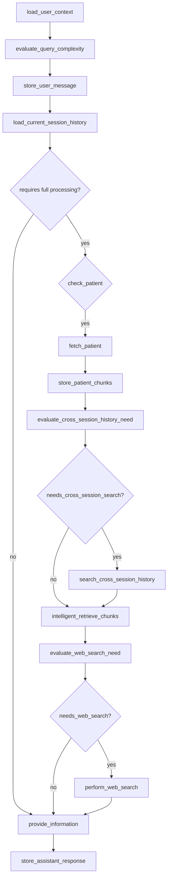

## Executive Summary
State graph for `info_flow.py` showing major nodes and conditional branches.

Notes
- Entry point: `load_user_context`.
- Branches: patient presence, cross-session need, web search need.

