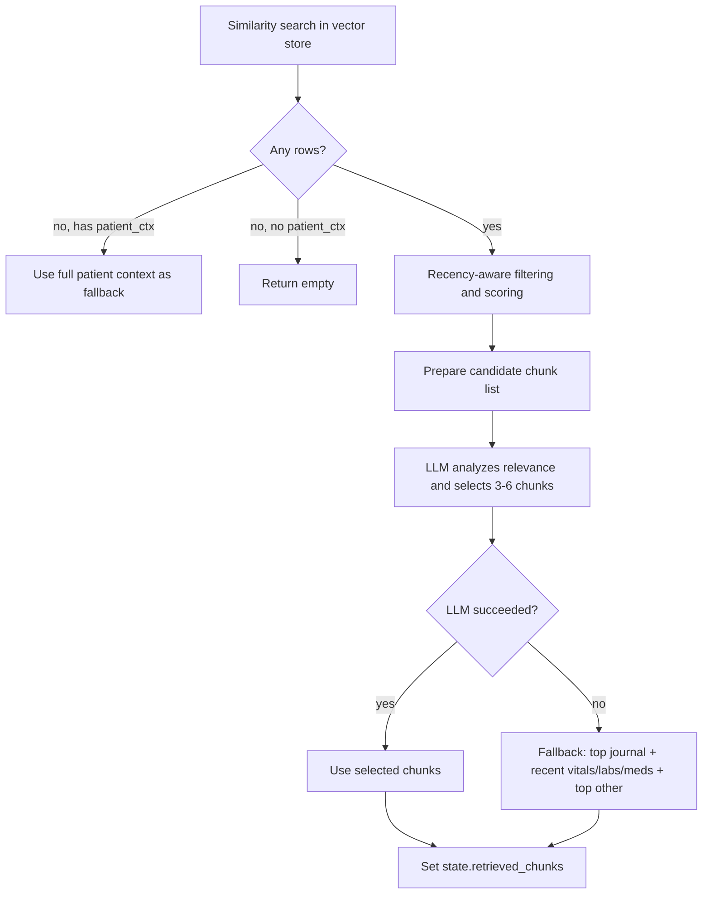
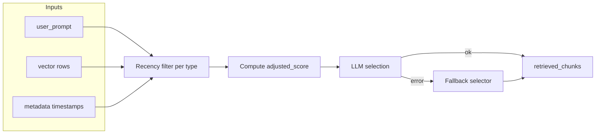

## Executive Summary
This function selects the most relevant patient data “chunks” to answer a query. It combines vector similarity search, recency-aware filtering by data type, and an LLM-based selector with a robust fallback strategy.

## High-level Flow

## Detailed Steps
- Initial search:
  - Build query embedding for `state.user_prompt`.
  - Search `namespace=clinical` filtered by `patient_id`, `top_k=20` to support later filtering.
- Recency-aware filtering by `data_type` with thresholds:
  - vitals: 7 days; labs: 14 days; medications: 90 days; others: always relevant.
  - Skip stale time-sensitive chunks; compute `adjusted_score` with a recency boost for recent items.
- Candidate preparation:
  - Keep metadata like `data_type`, `timestamp`, and `adjusted_score`.
  - Ensure relevance to the current patient via patient_id/name string checks.
- LLM selection:
  - Prompt evaluates each chunk on relevance, clinical importance, and utility.
  - Returns JSON with `selected_chunks`, `reasoning`, and per-chunk scores.
- Fallback if LLM fails:
  - Picks top journal entries, top recent time-sensitive chunks by `adjusted_score`, and top remaining by similarity.

## Figure: Scoring and Selection

## Notes
- Returns both `state.retrieved_chunks` and a `state.chunk_analysis` JSON explaining choices.
- Designed to degrade gracefully: multiple fallbacks end in at least demographics or full patient context when available.

