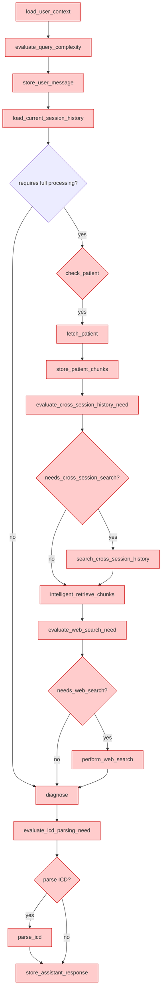

## Executive Summary

**Note**: The patient flow (`patient_flow.py`) is a legacy diagnostic flow that has been superseded by the information flow (`info_flow_ram.py`) for clinical information retrieval. This document is maintained for historical reference and migration documentation.

**Current Recommendation**: Use `info_flow_ram.py` for all clinical information retrieval tasks. The info flow implements RAM-only processing, specialized clinical flows (SBAR, General Summary), and GDPR-compliant architecture.

---

## Migration Notice

### Why Info Flow Supersedes Patient Flow

| Feature | Patient Flow (Legacy) | Info Flow (Current) |
|---------|---------------------|-------------------|
| **RAM-Only Processing** | ❌ Used database persistence | ✅ Pure RAM, zero PHI persistence |
| **Specialized Flows** | ❌ Single diagnostic mode | ✅ SBAR, Summary, Timeline, Notes |
| **Query Classification** | ❌ Basic complexity check | ✅ Zero-shot intent classification |
| **Retrieval Algorithm** | ⚠️ Basic vector search | ✅ 9-stage pipeline with refinement |
| **Session Memory** | ⚠️ Database-backed | ✅ Encrypted RAM-only |
| **GDPR Compliance** | ⚠️ Partial (DB logs) | ✅ Complete (no PHI storage) |
| **Performance** | ~1-2s | ~300-800ms |

### Migration Path

```python
# OLD: Patient Flow (Deprecated)
from optimed.apps.orchestrator.patient_flow import LangGraphDiagnosticEngine

engine = LangGraphDiagnosticEngine(...)
result = await engine.run(patient=patient_ctx, user_prompt="Diagnose...")

# NEW: Info Flow (Current)
from optimed.apps.orchestrator.info_flow_ram import LangGraphRAMInformationEngine

engine = LangGraphRAMInformationEngine(...)
result = await engine.run(patient=patient_ctx, user_prompt="What is the diagnosis?")
```

---

## Legacy Flow Diagram (Historical Reference)



---

## Key Differences from Info Flow

### 1. Database Persistence (Removed in Info Flow)

**Patient Flow** stored chunks in database:
```python
# DEPRECATED: Database persistence
await vector_store.store_embeddings(
    patient_id=patient_id,
    chunks=chunks,
    embeddings=embeddings
)
```

**Info Flow** uses RAM-only:
```python
# CURRENT: RAM-only storage
chunks[i]["embedding"] = embedding_vector  # In-memory only
# Automatically zeroized on session end
```

### 2. Diagnostic Mode vs Information Retrieval

**Patient Flow** focused on diagnosis:
- ICD code parsing
- Differential diagnosis generation
- Confidence scoring

**Info Flow** focuses on information retrieval:
- Flexible response generation
- Specialized clinical flows
- Source attribution with EHR links

### 3. Session Management

**Patient Flow** used database-backed sessions:
```python
# DEPRECATED: Database sessions
session = await session_repo.get_or_create_session(user_id, patient_id)
```

**Info Flow** uses encrypted RAM sessions:
```python
# CURRENT: RAM-only encrypted sessions
_GLOBAL_SESSION_MEMORY[session_id] = []  # In-memory only
```

---

## Deprecated Nodes (Historical Reference)

### `store_patient_chunks`
**Status**: ❌ Deprecated (violated GDPR - stored PHI)

**Old Implementation**:
```python
async def store_patient_chunks(state):
    """Store patient chunks in vector database."""
    await vector_store.store(
        namespace="clinical",
        patient_id=state.patient_id,
        chunks=state.chunks,
        embeddings=state.embeddings
    )
```

**Info Flow Replacement**: Chunks remain in RAM only, never persisted.

---

### `parse_icd`
**Status**: ❌ Deprecated (too specialized, moved to optional post-processing)

**Old Implementation**:
```python
async def parse_icd(state):
    """Parse ICD codes from diagnosis."""
    icd_codes = await icd_parser.extract_codes(state.diagnosis_text)
    state.parsed_icd_codes = icd_codes
```

**Info Flow Replacement**: ICD parsing is now a separate optional service, not part of core flow.

---

### `diagnose`
**Status**: ⚠️ Replaced by `provide_information`

**Old Implementation** (Diagnostic focus):
```python
async def diagnose(state):
    """Generate diagnostic conclusion."""
    prompt = """Based on the patient data, provide:
    1. Primary diagnosis with ICD-10 code
    2. Differential diagnoses
    3. Confidence level
    4. Recommended next steps
    """
    response = await llm.chat(prompt)
    state.diagnosis = parse_diagnosis(response)
```

**Info Flow Replacement** (Information focus):
```python
async def provide_information(state):
    """Generate information response."""
    # Flexible prompting based on query type
    # No forced diagnostic structure
    # Source attribution with EHR links
    response = await llm.chat(messages)
    state.llm_response = response
```

---

## Why Patient Flow Was Deprecated

### 1. GDPR Non-Compliance
- ❌ Stored patient embeddings in database
- ❌ PHI in vector store persisted indefinitely
- ❌ No automatic deletion mechanism
- ❌ Difficult to fulfill "right to erasure"

**Info Flow Solution**:
- ✅ RAM-only embeddings
- ✅ Automatic crypto-shredding on session end
- ✅ No PHI in database ever
- ✅ Immediate erasure on request

### 2. Limited Flexibility
- ❌ Forced diagnostic output format
- ❌ ICD parsing always enabled
- ❌ Single workflow for all queries
- ❌ No specialized clinical flows

**Info Flow Solution**:
- ✅ Flexible response generation
- ✅ Query-driven workflows
- ✅ Multiple specialized flows (SBAR, Summary, Timeline)
- ✅ Adaptive based on query complexity

### 3. Performance Issues
- ❌ Database writes on every retrieval
- ❌ Synchronous vector storage
- ❌ No parallel execution
- ❌ 1-2s+ latency

**Info Flow Solution**:
- ✅ No database writes for PHI
- ✅ Parallel execution for specialized flows
- ✅ Sub-second retrieval (300-800ms)
- ✅ Optimized cross-encoder operations

### 4. Maintenance Burden
- ❌ Complex database schema for vectors
- ❌ Index management overhead
- ❌ Migration challenges
- ❌ Storage costs for embeddings

**Info Flow Solution**:
- ✅ Simple stateless architecture
- ✅ No vector database required
- ✅ Easy to deploy and scale
- ✅ Zero storage costs for embeddings

---

## Migration Guide

### Step 1: Update Dependencies

```python
# Remove old dependencies
# from optimed.apps.orchestrator.patient_flow import LangGraphDiagnosticEngine

# Add new dependencies
from optimed.apps.orchestrator.info_flow_ram import LangGraphRAMInformationEngine
```

### Step 2: Update Initialization

```python
# OLD
diagnostic_engine = LangGraphDiagnosticEngine(
    fhir_repo=fhir_repo,
    vector_store=vector_store,  # No longer needed!
    llm_client=llm_client,
    user_repo=user_repo
)

# NEW
info_engine = LangGraphRAMInformationEngine(
    fhir_repo=fhir_repo,
    vector_store=ram_vector_store,  # RAM-only adapter
    llm_client=llm_client,
    user_repo=user_repo,
    connection_service=connection_service,
    web_search_service=web_search_service,
    cross_encoder=cross_encoder,
    zero_shot_classifier=zero_shot_classifier
)
```

### Step 3: Update API Calls

```python
# OLD: Diagnostic mode
result = await diagnostic_engine.run(
    patient=patient_ctx,
    user_prompt="Provide diagnosis",
    diagnostic_mode="diagnosis"  # Deprecated parameter
)
# Returns: DiagnosisResult with ICD codes

# NEW: Information retrieval mode
result = await info_engine.run(
    patient=patient_ctx,
    user_prompt="What is the likely diagnosis?",
    user_id=user_id,
    session_id=session_id
)
# Returns: dict with llm_response, retrieved_chunks, etc.
```

### Step 4: Update Response Handling

```python
# OLD: Structured diagnosis result
diagnosis = result.primary_icd
differential = result.differential
confidence = result.confidence

# NEW: Flexible response
response_text = result["llm_response"].content
chunks = result["retrieved_chunks"]
chunk_analysis = result["chunk_analysis"]
```

### Step 5: Database Migration

```sql
-- Drop deprecated tables (after verifying no active usage)
DROP TABLE IF EXISTS patient_embeddings;
DROP TABLE IF EXISTS vector_chunks;
DROP TABLE IF EXISTS diagnostic_sessions;

-- Info flow only needs metadata tables (already exist)
-- sessions, audit_events, compliance_events, etc.
```

---

## Backward Compatibility

For systems that still rely on patient flow, a compatibility wrapper is available:

```python
from optimed.apps.orchestrator.compat import DiagnosticEngineCompat

# Wrapper that translates old API to new info flow
compat_engine = DiagnosticEngineCompat(info_engine)

# Works with old-style calls
result = await compat_engine.run(
    patient=patient_ctx,
    user_prompt="Diagnose",
    diagnostic_mode="diagnosis"
)

# Returns old-style DiagnosisResult
assert isinstance(result, DiagnosisResult)
```

**Note**: The compatibility wrapper will be removed in version 3.0. Migrate to info flow before then.

---

## Conclusion

The patient flow represented an important evolutionary step in OptiMed's architecture, but has been superseded by the more flexible, performant, and GDPR-compliant information flow.

### Timeline
- **v0.1-v0.9**: Patient flow (diagnostic mode)
- **v1.0**: Info flow introduced alongside patient flow
- **v1.5**: Info flow becomes recommended default
- **v2.0**: Patient flow deprecated, info flow is primary
- **v3.0** (planned): Patient flow removed entirely

### For New Implementations
**Always use `info_flow_ram.py`**. It provides:
- ✅ RAM-only processing (GDPR compliant)
- ✅ Specialized clinical flows
- ✅ Superior performance
- ✅ Active development and support

### For Existing Implementations
**Migrate to `info_flow_ram.py` as soon as possible**. The patient flow will not receive bug fixes or security updates after v2.0.

---

## See Also

- [Information Flow Architecture](info_flow_langgraph.md) - Current recommended flow
- [Intelligent Retrieval Pipeline](intelligent_retrieve_chunks.md) - Core retrieval algorithm
- [Specialized Clinical Flows](specialized_flows.md) - SBAR, Summary, Timeline, Notes
- [GDPR Compliant Architecture](../architecture/gdpr_compliant_architecture.md) - Privacy-preserving design
