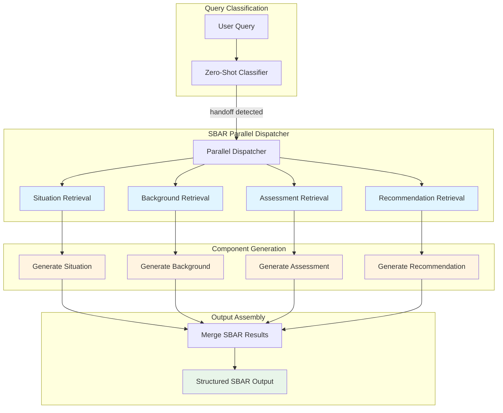
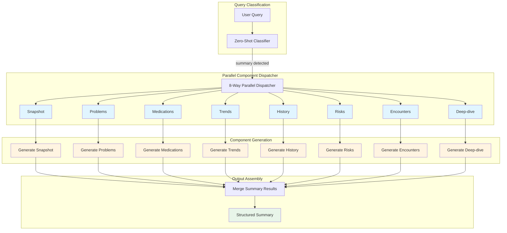
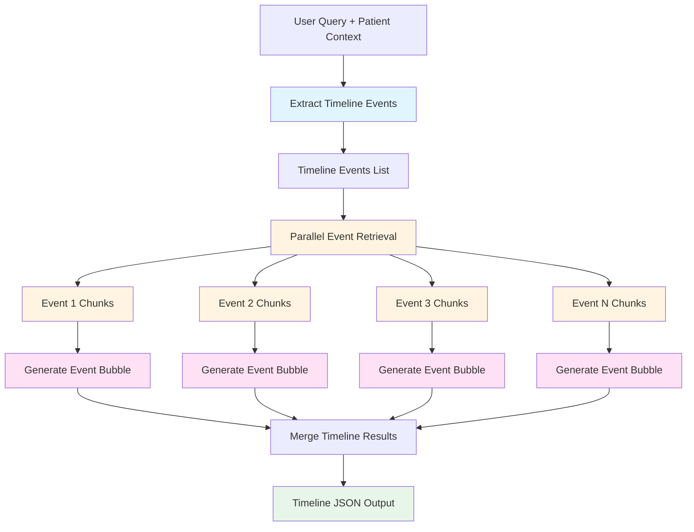
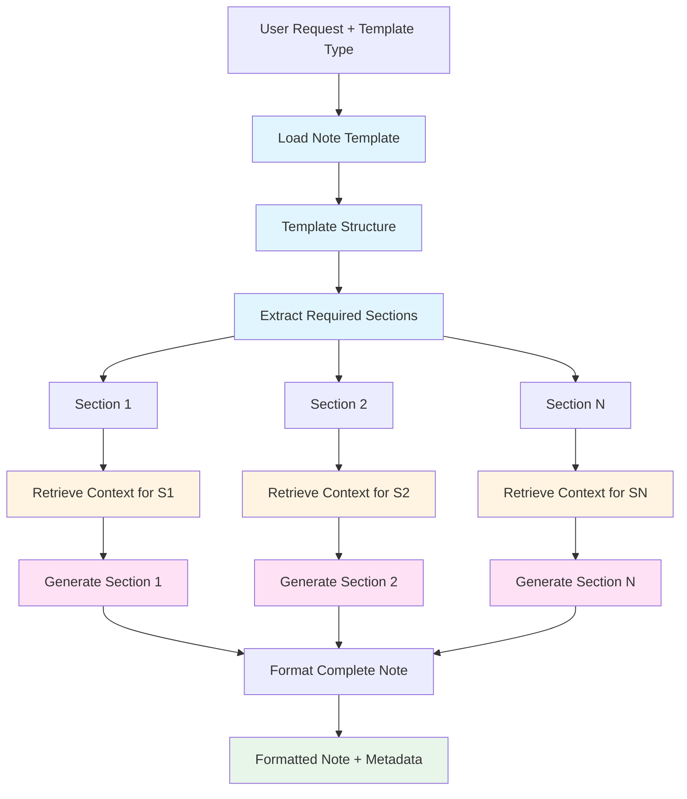

## Executive Summary

OptiMed implements specialized clinical information flows optimized for specific healthcare documentation and communication patterns. These flows use targeted retrieval strategies and structured outputs to meet clinical workflow requirements while maintaining GDPR compliance and performance.

## Overview

The system supports four specialized flows beyond standard information retrieval:

1. **SBAR Flow**: Clinical handoff communication (Situation-Background-Assessment-Recommendation)
2. **General Summary Flow**: Comprehensive patient overview across 8 dimensions
3. **Timeline Flow**: Chronological patient journey visualization
4. **Note Generation Flow**: Template-driven clinical documentation

All flows implement:
- RAM-only processing (no PHI persistence)
- Parallel retrieval for performance
- Component-specific query generation
- EHR source link preservation
- GDPR-compliant audit logging

---

## 1. SBAR Flow (Clinical Handoff)

### Purpose

SBAR is a standardized communication framework for clinical handoffs, ensuring critical patient information is conveyed consistently during shift changes, transfers, or consultations.

### Architecture



### Components

#### Situation
- **Focus**: Current clinical status and immediate concerns
- **Queries**: Chief complaint, recent vitals, active symptoms
- **Retrieval Strategy**: Fast bi-encoder only (no cross-encoder for speed)
- **Typical Sources**: Recent vitals (7 days), active problems, current medications

#### Background
- **Focus**: Relevant medical history and context
- **Queries**: Medical history, chronic conditions, surgical history
- **Retrieval Strategy**: Fast bi-encoder with historical data prioritization
- **Typical Sources**: Problem list, past procedures, medication history

#### Assessment
- **Focus**: Clinical evaluation and significance
- **Queries**: Recent lab results, diagnostic findings, clinical trends
- **Retrieval Strategy**: Fast bi-encoder with lab/diagnostic focus
- **Typical Sources**: Recent labs (14 days), imaging reports, clinical notes

#### Recommendation
- **Focus**: Suggested actions and follow-up
- **Queries**: Treatment plan, pending orders, follow-up needs
- **Retrieval Strategy**: Fast bi-encoder with action-oriented filtering
- **Typical Sources**: Care plans, pending orders, follow-up appointments

### Query Generation

Each component uses LLM-based query generation for optimal retrieval:

```python
async def _generate_sbar_queries(state: FlowState, component: str, focus: str) -> List[str]:
    """Generate 3-5 targeted queries for SBAR component."""
    prompt = f"""Given patient context and component focus, generate 3-5 specific search queries.

    Component: {component}
    Focus: {focus}
    Patient Context: {state.patient_ctx}

    Return JSON: {{"queries": ["query1", "query2", ...]}}
    """
    # LLM generates component-specific queries
    return queries
```

### Performance Optimization

SBAR flow uses **fast bi-encoder retrieval** exclusively (skips cross-encoder reranking) for sub-second component retrieval:

- **Bi-encoder cosine similarity**: 100-200μs per chunk
- **No cross-encoder**: Saves 10-50ms per component
- **Parallel execution**: All 4 components retrieved simultaneously
- **Total retrieval time**: ~300-500ms (vs 2-3s with cross-encoder)

### Output Format

```markdown
# Clinical Handoff - [Patient Name]

## 🎯 Situation
[Current status with vital sign trends and immediate concerns]
**Sources**: [Vital Signs 2025-01-27](ehr-link) | [Current Medications](ehr-link)

## 📋 Background
[Relevant medical history and context]
**Sources**: [Problem List](ehr-link) | [Surgical History](ehr-link)

## 🔍 Assessment
[Clinical evaluation with recent results]
**Sources**: [Lab Results 2025-01-25](ehr-link) | [Imaging Report](ehr-link)

## 💡 Recommendation
[Suggested actions and follow-up]
**Sources**: [Care Plan](ehr-link) | [Follow-up Schedule](ehr-link)
```

---

## 2. General Summary Flow

### Purpose

Comprehensive patient overview across 8 clinical dimensions, providing clinicians with a holistic view of patient status, history, and risk factors.

### Architecture



### Eight Components

#### 1. Snapshot (Current Status)
- **Focus**: Current vital signs, recent observations, active issues
- **Time Window**: Last 7 days
- **Retrieval**: Most recent vitals, active problems, current medications
- **Output**: Tabular current status with trends

#### 2. Problems (Active & Historical)
- **Focus**: Problem list, diagnoses, active conditions
- **Priority**: Active problems first, then resolved/historical
- **Retrieval**: Problem list, diagnosis history, condition status
- **Output**: Categorized problem list with onset dates

#### 3. Medications (Current & Recent)
- **Focus**: Active medications, recent changes, allergies
- **Time Window**: Current + last 90 days
- **Retrieval**: Medication orders, administration records, allergies
- **Output**: Medication list with purpose, dosage, start date

#### 4. Trends (Clinical Trajectory)
- **Focus**: Vital sign trends, lab value changes, disease progression
- **Time Window**: Last 30-90 days
- **Retrieval**: Serial vitals, trending labs, repeated measurements
- **Output**: Narrative trends with direction indicators (↑↓→)

#### 5. History (Medical Background)
- **Focus**: Past medical history, surgical history, family history
- **Time Window**: All historical data
- **Retrieval**: Historical problems, past procedures, family history
- **Output**: Chronological medical history summary

#### 6. Risks (Clinical Risk Factors)
- **Focus**: Risk stratification, prevention opportunities, alerts
- **Analysis**: Cardiovascular risk, fall risk, infection risk
- **Retrieval**: Risk assessment data, screening results, alerts
- **Output**: Categorized risk assessment with recommendations

#### 7. Encounters (Recent Interactions)
- **Focus**: Recent visits, admissions, procedures
- **Time Window**: Last 6-12 months
- **Retrieval**: Encounter records, visit summaries, procedure notes
- **Output**: Timeline of recent healthcare interactions

#### 8. Deep-dive (Contextual Analysis)
- **Focus**: Query-specific deep analysis based on user prompt
- **Adaptive**: Uses original query to focus on specific areas
- **Retrieval**: Targeted based on query intent
- **Output**: Contextual analysis addressing user's specific question

### Parallel Execution

All 8 components execute in parallel:
- **Individual retrieval**: 300-500ms per component
- **Parallel execution**: ~500-800ms total (vs ~4-6s sequential)
- **LLM generation**: Streamed concurrently
- **Total time to first token**: <1 second

### Output Format

```markdown
# Comprehensive Patient Summary - [Patient Name]

## 📊 Current Snapshot
[Current vital signs and status]
| Vital | Value | Trend | Last Updated |
|-------|-------|-------|--------------|
| BP | 120/80 | ↓ | 2025-01-27 |
...

## 🔴 Active Problems
1. **Hypertension** (since 2020) - Controlled [Source](ehr-link)
2. **Type 2 Diabetes** (since 2018) - Managed [Source](ehr-link)
...

## 💊 Current Medications
1. **Lisinopril 10mg daily** (antihypertensive) [Source](ehr-link)
2. **Metformin 500mg BID** (diabetes management) [Source](ehr-link)
...

## 📈 Clinical Trends
- **Blood Pressure**: Decreasing trend over 3 months (↓ 145/95 → 125/82)
- **HbA1c**: Stable at 6.8% [Source](ehr-link)
...

## 📚 Medical History
- **Surgical**: Appendectomy (2015), Cholecystectomy (2019)
- **Medical**: Family history of CAD (father)
...

## ⚠️ Risk Factors
- **Cardiovascular**: Moderate risk (HTN, DM, age 55)
- **Fall Risk**: Low
...

## 🏥 Recent Encounters
- **2025-01-20**: Primary Care Visit - HTN follow-up
- **2024-12-15**: Lab Work - HbA1c, lipid panel
...

## 🔍 Contextual Analysis
[Deep-dive based on original query context]
...
```

---

## 3. Timeline Flow

### Purpose

Chronological visualization of patient journey, extracting key events and presenting them as interactive timeline bubbles.

### Architecture



### Event Extraction

LLM analyzes patient context to identify significant clinical events:

```python
async def extract_timeline_events(state: FlowState) -> FlowState:
    """Extract 8-12 key events from patient history."""
    prompt = f"""Analyze patient history and extract 8-12 significant events.

    Event types:
    - Diagnoses (new conditions identified)
    - Procedures (surgeries, interventions)
    - Hospitalizations (admissions, ER visits)
    - Medication changes (new Rx, discontinuations)
    - Critical results (abnormal labs, imaging findings)
    - Life events (pregnancy, smoking cessation)

    Return JSON: {{
        "events": [
            {{
                "date": "2023-05-15",
                "type": "diagnosis",
                "description": "Type 2 Diabetes Diagnosed",
                "time_period": "May 2023"
            }},
            ...
        ]
    }}
    """
    return extracted_events
```

### Event-Specific Retrieval

For each event, generate targeted queries and retrieve supporting documentation:

```python
async def _generate_timeline_queries(event_description: str, time_period: str) -> List[str]:
    """Generate 2-3 queries for each timeline event."""
    queries = [
        f"{event_description} {time_period}",
        f"clinical notes {event_description}",
        f"results findings {event_description}"
    ]
    return queries
```

### Timeline Bubble Generation

Each event becomes a structured "bubble" with:
- **Date**: Event timestamp
- **Title**: Event description
- **Summary**: 2-3 sentence clinical summary
- **Details**: Supporting clinical details
- **Sources**: EHR source links

### Output Format

```json
{
    "timeline_events": [
        {
            "date": "2023-05-15",
            "type": "diagnosis",
            "title": "Type 2 Diabetes Mellitus Diagnosed",
            "summary": "Patient diagnosed with T2DM following elevated HbA1c of 8.2%. Initial presentation with polyuria and polydipsia. Started on metformin 500mg BID.",
            "details": "HbA1c: 8.2% (ref: <5.7%), Fasting glucose: 185 mg/dL, Random glucose: 245 mg/dL. Diabetes education provided, dietary counseling initiated.",
            "sources": [
                {"title": "Primary Care Visit 2023-05-15", "url": "ehr-link-1"},
                {"title": "Lab Results 2023-05-12", "url": "ehr-link-2"}
            ],
            "severity": "moderate"
        },
        {
            "date": "2023-08-20",
            "type": "medication_change",
            "title": "Insulin Therapy Initiated",
            "summary": "Added Lantus 10 units QHS due to inadequate glycemic control on metformin alone. HbA1c remained 7.8%.",
            "details": "Metformin continued at 1000mg BID. Patient education on insulin administration and glucose monitoring provided. Target HbA1c <7%.",
            "sources": [
                {"title": "Endocrinology Consult 2023-08-20", "url": "ehr-link-3"}
            ],
            "severity": "moderate"
        }
    ],
    "timeline_metadata": {
        "total_events": 12,
        "date_range": "2023-05-15 to 2025-01-27",
        "duration_months": 20
    }
}
```

---

## 4. Note Generation Flow

### Purpose

Template-driven clinical documentation generation following standard medical note formats (SOAP, Progress, Admission, Discharge, etc.).

### Supported Templates

1. **SOAP Note** (Subjective-Objective-Assessment-Plan)
2. **Progress Note** (Daily progress documentation)
3. **Admission Note** (Initial hospital admission)
4. **Discharge Summary** (Post-discharge documentation)
5. **Consultation Note** (Specialist consultation)
6. **Procedure Note** (Procedural documentation)

### Architecture



### Template Structure

Each template defines required sections and retrieval strategies:

```python
class NoteTemplate:
    """Template for clinical note generation."""
    template_type: str  # "soap", "progress", "admission", etc.
    sections: List[NoteSection]
    formatting_rules: Dict[str, Any]
    required_elements: List[str]

class NoteSection:
    """Individual section within note template."""
    section_name: str
    retrieval_focus: str  # What data to retrieve
    generation_prompt: str  # How to format
    required_elements: List[str]
    max_length: Optional[int]
```

### Example: SOAP Note Template

```python
SOAP_TEMPLATE = NoteTemplate(
    template_type="soap",
    sections=[
        NoteSection(
            section_name="Subjective",
            retrieval_focus="patient complaints, symptoms, current concerns",
            generation_prompt="Summarize patient's subjective experience...",
            required_elements=["chief_complaint", "history_present_illness"]
        ),
        NoteSection(
            section_name="Objective",
            retrieval_focus="vital signs, physical exam, lab results",
            generation_prompt="Present objective clinical findings...",
            required_elements=["vitals", "physical_exam"]
        ),
        NoteSection(
            section_name="Assessment",
            retrieval_focus="diagnoses, clinical impression, problem list",
            generation_prompt="Provide clinical assessment...",
            required_elements=["primary_diagnosis", "differential"]
        ),
        NoteSection(
            section_name="Plan",
            retrieval_focus="treatment plan, medications, follow-up",
            generation_prompt="Outline management plan...",
            required_elements=["medications", "follow_up"]
        )
    ]
)
```

### Section-by-Section Generation

Each section is generated independently with targeted retrieval:

1. **Retrieval Phase**: Fetch section-specific clinical data
2. **Generation Phase**: LLM generates formatted section text
3. **Source Tracking**: Maintain EHR source links throughout
4. **Validation**: Ensure required elements are present

### Output Format

```markdown
# Progress Note - [Patient Name]
**Date**: 2025-01-27
**Author**: [Provider Name]
**Note Type**: Daily Progress Note

## Subjective
Patient reports feeling "much better" today. Chest pain resolved after nitroglycerin administration yesterday evening. Denies shortness of breath, palpitations, or dizziness. Sleeping well without orthopnea.

**Sources**: [Nursing Assessment 2025-01-27](ehr-link) | [Patient Interview](ehr-link)

## Objective
**Vital Signs**:
- BP: 125/78 mmHg
- HR: 72 bpm
- RR: 16/min
- SpO2: 98% on room air
- Temp: 36.8°C

**Physical Exam**: Alert and oriented x3. Heart regular rate and rhythm, no murmurs. Lungs clear bilaterally. No peripheral edema.

**Labs**: Troponin < 0.01 ng/mL (normal), BNP 85 pg/mL

**Sources**: [Vital Signs 2025-01-27](ehr-link) | [Lab Results](ehr-link)

## Assessment
1. **Chest pain, resolved** - Likely atypical angina vs musculoskeletal. Cardiac enzymes negative. EKG unchanged.
2. **Hypertension** - Well-controlled on current regimen
3. **Type 2 Diabetes** - Glucose monitoring pending

## Plan
1. Continue telemetry monitoring for 24 hours
2. Repeat cardiac enzymes at 6 hours (pending)
3. Cardiology consult if any recurrence of symptoms
4. Continue home medications (lisinopril, metformin)
5. Discharge planning if remains stable

**Sources**: [Care Plan 2025-01-27](ehr-link) | [Cardiology Orders](ehr-link)

---
**Note Generated**: 2025-01-27 10:30 UTC
**Generation ID**: ng_abc123
**Verification**: Awaiting provider signature
```

---

## Performance Characteristics

### Retrieval Performance

| Flow Type | Components | Retrieval Strategy | Avg Time | Total Time |
|-----------|------------|-------------------|----------|------------|
| SBAR | 4 parallel | Bi-encoder only | 100-150ms/component | 300-500ms |
| General Summary | 8 parallel | Bi-encoder only | 100-150ms/component | 500-800ms |
| Timeline | 8-12 parallel | Bi-encoder + targeted | 150-200ms/event | 800-1200ms |
| Note Generation | 4-6 sections | Bi-encoder + context | 150-200ms/section | 600-1000ms |

### Memory Usage

All flows maintain RAM-only processing:
- **Chunk embeddings**: 512 dimensions × 4 bytes = 2KB per chunk
- **Typical patient**: 100-300 chunks = 200-600KB
- **Session memory**: 1-2MB per active session
- **Peak memory**: <100MB for 50 concurrent sessions

### GDPR Compliance

All flows implement:
- ✅ No PHI persistence in database
- ✅ RAM-only embedding storage
- ✅ Ephemeral session memory with TTL
- ✅ Crypto-shredding on session end
- ✅ Complete audit trail logging
- ✅ Data lineage tracking
- ✅ Source attribution with EHR links

---

## Integration with Main Flow

### Query Classification

Zero-shot classifier determines which specialized flow to trigger:

```python
classifier.classify_query(query, [
    "lookup",      # Simple fact retrieval
    "reasoning",   # Complex analysis (uses full retrieval)
    "comparative", # Comparison tasks
    "guideline",   # Evidence-based guidelines
    "handoff",     # -> Triggers SBAR flow
    "summary"      # -> Triggers General Summary flow
])
```

### Flow Routing

```python
def route_after_classification(state: FlowState) -> str:
    if state.is_sbar_flow:
        return "sbar_parallel_dispatcher"
    elif state.is_general_summary_flow:
        return "general_summary_parallel_dispatcher"
    elif state.is_timeline_flow:
        return "extract_timeline_events"
    elif state.is_note_generation_flow:
        return "load_note_template"
    else:
        return "check_patient_exists"  # Standard flow
```

---

## Future Enhancements

### Planned Improvements

1. **Adaptive Component Selection**: Machine learning to determine which summary components are most relevant
2. **Custom Templates**: User-defined note templates with institution-specific requirements
3. **Multi-Patient Summaries**: Census-level summaries for team rounds
4. **Predictive Timelines**: ML-based prediction of future events based on trajectory
5. **Interactive SBAR**: Conversational refinement of handoff content

### Research Areas

- **Automated Template Selection**: Intent-based template recommendation
- **Quality Metrics**: Automated note quality assessment
- **Cross-Patient Analytics**: Population-level insights while preserving privacy
- **Real-time Collaboration**: Multi-user simultaneous note generation

---

## Conclusion

Specialized clinical flows in OptiMed provide targeted, high-performance information retrieval and documentation generation optimized for specific healthcare workflows. By combining intelligent query classification, parallel execution, and component-specific retrieval strategies, the system delivers sub-second response times while maintaining GDPR compliance and comprehensive audit trails.

These flows demonstrate how advanced ML techniques (zero-shot classification, multilingual cross-encoders, parallel retrieval) can be combined with domain-specific clinical knowledge to create powerful tools that enhance clinical efficiency without compromising patient privacy or data security.
