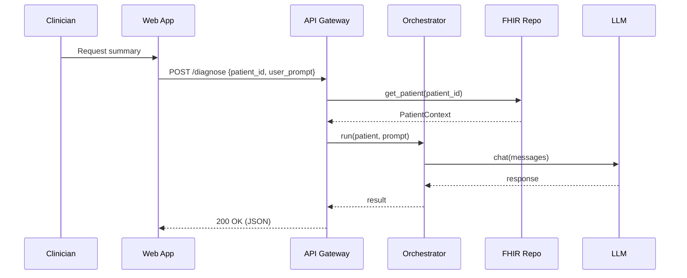
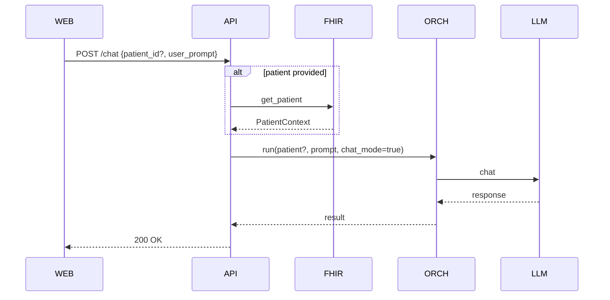
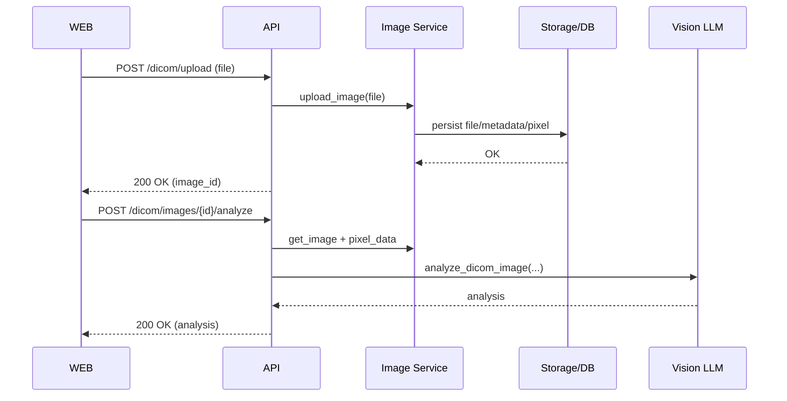
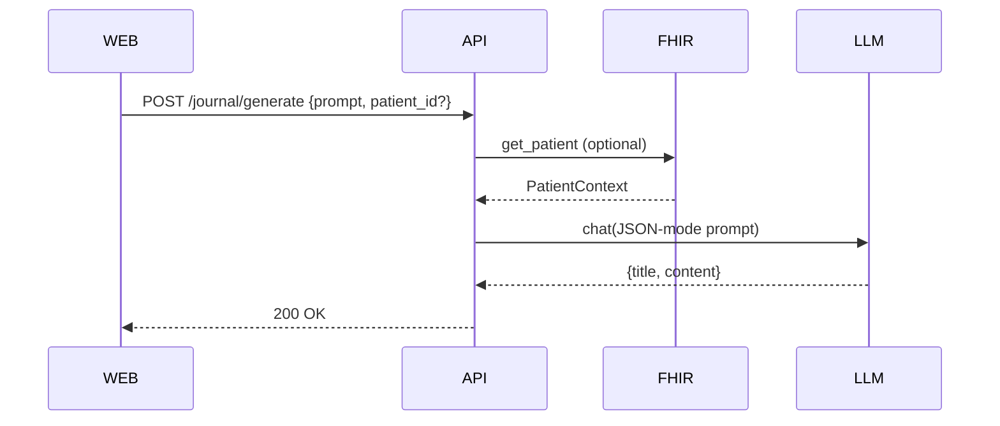

## Executive Summary
This doc details key read/write flows: patient retrieval and summarization, diagnostic reasoning, general chat, DICOM upload/analysis, and journal generation. It also provides sequence diagrams and pseudocode for critical paths.

## Flow A: Patient Query → Retrieval → Reasoning → Response


Pseudocode
```
patient = fhir_repo.get_patient(pid)
result = engine.run(patient, prompt, user_id, session_id)
return result
```

## Flow B: Chat (with/without patient)


## Flow C: DICOM Upload → Process → Analyze


## Flow D: Journal Generation


Stakeholder Notes
- Data minimization: only required fields are retrieved and cached.
- Journal content is user-driven and should be reviewed before storing in EHR.

Update instructions
- Update diagrams if endpoints or steps change; keep pseudocode in sync with orchestrator.


