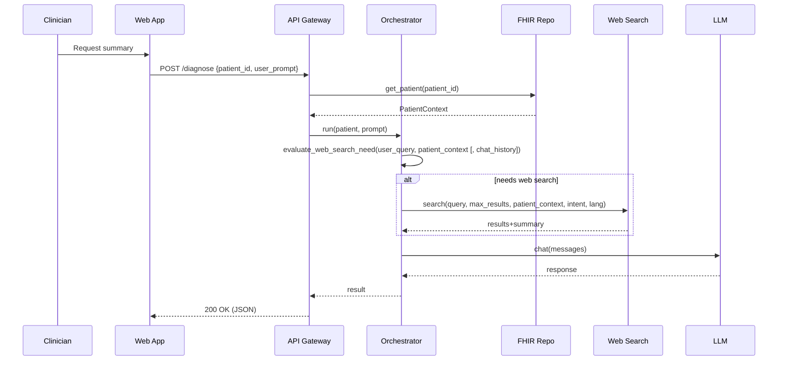
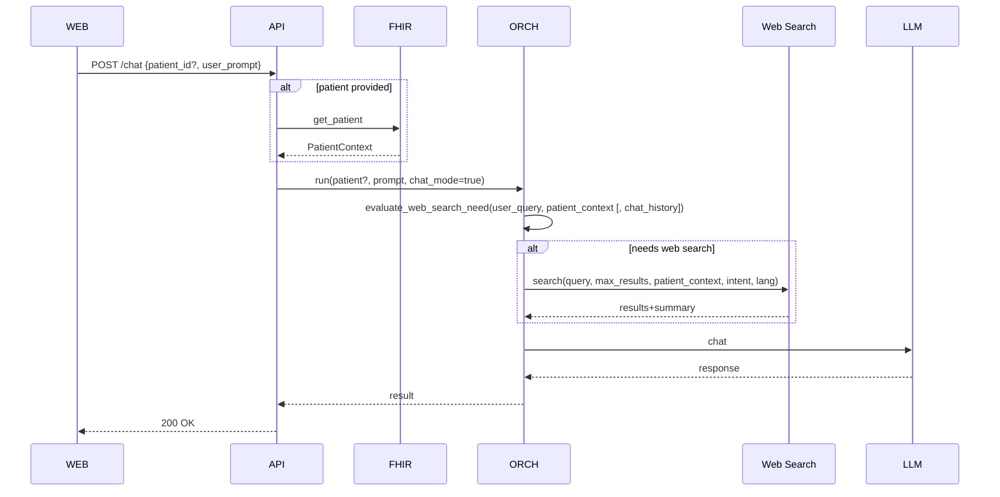
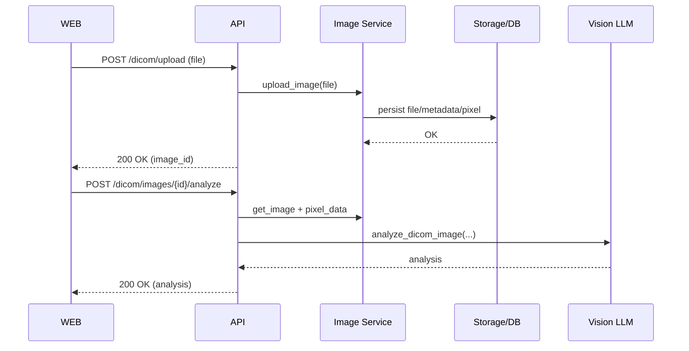
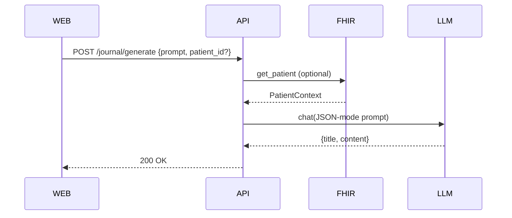
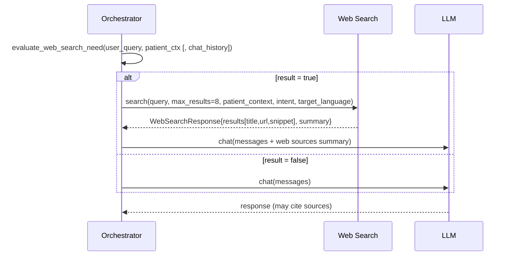

## Executive Summary
This doc details key read/write flows: patient retrieval and summarization, diagnostic reasoning, general chat, DICOM upload/analysis, and journal generation. It also provides sequence diagrams and pseudocode for critical paths.

## Flow A: Patient Query → Retrieval → Reasoning → Response


Pseudocode
```
patient = fhir_repo.get_patient(pid)
result = engine.run(patient, prompt, user_id, session_id)
return result
```

## Flow B: Chat (with/without patient)


## Flow C: DICOM Upload → Process → Analyze


## Flow D: Journal Generation


## Flow E: Web Search Decision and Integration (Patient and Info Flows)


Pseudocode (diagnostic flow)
```
# patient_flow
needs = web_search.evaluate_search_need(user_query, patient_context)
if needs or diagnostic_mode == "research":
    resp = web_search.search(query, max_results=8, patient_context, search_intent="diagnostic_support", target_language=detect_language(user_query))
    state.web_search_response = resp
# proceed to diagnosis with sources included in messages
```

Pseudocode (information flow)
```
# info_flow
needs = web_search.evaluate_search_need(user_query, patient_context, chat_history=last_messages)
if needs:
    resp = web_search.search(query, max_results=8, patient_context, search_intent="clinical_information", target_language=detect_language(user_query))
    state.web_search_response = resp
# LLM crafts answer and may cite URLs from resp.results
```

Stakeholder Notes
- Data minimization: only required fields are retrieved and cached.
- Journal content is user-driven and should be reviewed before storing in EHR.
 - Web results are advisory; clinicians should validate sources. Non-authoritative links should be de-emphasized.

Update instructions
- Update diagrams if endpoints or steps change; keep pseudocode in sync with orchestrator.


