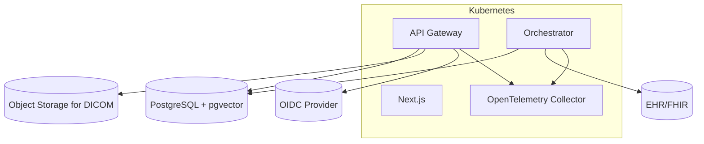

## Executive Summary
Deploy CLARA in EU regions (GDPR). Use Kubernetes for API/orchestrators and Next.js frontend, with PostgreSQL/pgvector and object storage for DICOM files. Enable blue/green or canary releases via CI/CD.

## Environments
- dev: local Docker/Compose or k3d
- stage: pre-production with synthetic data
- prod: EU regions only

## Deployment Diagram

Assumptions
- Ingress with TLS; optional service mesh.
- Horizontal Pod Autoscaling for API/ORCH; resource requests/limits set.

Backup/Restore
- DB: daily snapshots, PITR; RPO ≤ 24h, RTO ≤ 4h.
- Object storage lifecycle policies.

Stakeholder Notes
- Ensure data residency and vendor compliance lists are kept up to date.

Update instructions
- Edit diagram and environment values when infrastructure changes.

