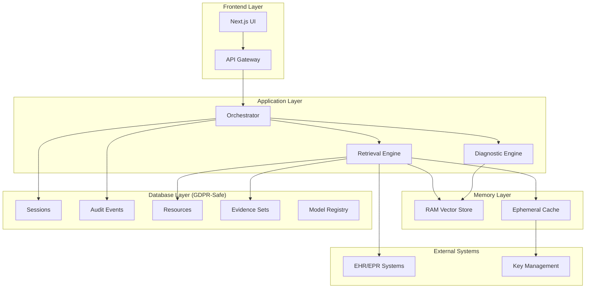

## Executive Summary

This document describes the GDPR-compliant architecture implemented to ensure no PHI (Protected Health Information) is persisted in durable storage while maintaining system functionality and auditability.

## Key Principles

### Data Minimization
- **No PHI Storage**: Patient content, embeddings, and conversation history are not stored in the database
- **Metadata Only**: Only resource metadata, provenance, and audit information is persisted
- **RAM-Only Embeddings**: Vector embeddings exist only in memory and are zeroized on shutdown

### Purpose Limitation
- **Lawful Basis**: All processing requires explicit lawful basis (e.g., "care_delivery")
- **Purpose Tracking**: Every session tracks its purpose of use
- **Scope Enforcement**: Processing is limited to authorized scopes

### Data Subject Rights
- **Right to Erasure**: Crypto-shredding provides immediate logical deletion
- **Data Portability**: Evidence pointers enable reconstruction from EHR
- **Transparency**: Complete audit trail of all data access

## Architecture Overview



## Database Schema

### Core Tables

#### Sessions
```sql
CREATE TABLE sessions (
    session_id UUID PRIMARY KEY,
    subject_hash BYTEA NOT NULL,          -- Pseudonymized patient ID
    user_id UUID NOT NULL,
    tenant_id UUID NOT NULL,
    lawful_basis TEXT NOT NULL,           -- GDPR lawful basis
    purpose_of_use TEXT NOT NULL,         -- Purpose limitation
    scopes TEXT[],                        -- Authorized scopes
    model_config_hash BYTEA NOT NULL,
    started_at TIMESTAMPTZ NOT NULL,
    ended_at TIMESTAMPTZ
);
```

#### Audit Events
```sql
CREATE TABLE audit_events (
    id BIGSERIAL PRIMARY KEY,
    session_id UUID REFERENCES sessions(session_id),
    action TEXT NOT NULL,                 -- FETCH, RANK, SYNTHESIZE, etc.
    resource_type TEXT,
    resource_id TEXT,
    outcome TEXT,
    latency_ms INT,
    occurred_at TIMESTAMPTZ NOT NULL
);
```

#### Resources (Metadata Only)
```sql
CREATE TABLE resources (
    id BIGSERIAL PRIMARY KEY,
    subject_hash BYTEA NOT NULL,          -- Pseudonymized patient ID
    server_alias TEXT NOT NULL,           -- EHR system identifier
    resource_type TEXT NOT NULL,          -- FHIR resource type
    resource_id TEXT NOT NULL,
    version_id TEXT,
    last_updated TIMESTAMPTZ,
    etag TEXT,
    has_binary BOOLEAN DEFAULT FALSE,
    byte_size INT,
    sha256 BYTEA                          -- Content hash for integrity
);
```

#### Evidence Sets (Pointers Only)
```sql
CREATE TABLE evidence_sets (
    id BIGSERIAL PRIMARY KEY,
    session_id UUID REFERENCES sessions(session_id),
    question_id UUID NOT NULL,
    rank INT NOT NULL,
    resource_type TEXT NOT NULL,
    resource_id TEXT NOT NULL,
    resource_version TEXT,
    section TEXT,                         -- Document section
    start_offset INT,                     -- Character offset
    end_offset INT,                       -- Character offset
    rerank_score REAL,
    reason TEXT                           -- Selection rationale
);
```

### Security Features

#### Row Level Security (RLS)
- **Tenant Isolation**: Users can only access data within their tenant
- **Session Scoping**: Data access is limited to active sessions
- **Audit Enforcement**: All access is logged automatically

#### Pseudonymization
- **Subject Hashing**: Patient IDs are salted and hashed
- **Consistent Mapping**: Same patient ID produces same hash within tenant
- **Salt Management**: Per-tenant salts prevent cross-tenant correlation

## Memory Management

### RAM-Only Embeddings
```python
class RAMVectorStore:
    """In-memory vector store with explicit zeroization."""
    
    def __init__(self, max_memory_mb: int = 1024):
        self.max_memory_bytes = max_memory_mb * 1024 * 1024
        self.embeddings: Dict[str, np.ndarray] = {}
    
    def zeroize(self):
        """Securely zeroize all data from memory."""
        for embedding in self.embeddings.values():
            embedding.fill(0)  # Overwrite with zeros
        self.embeddings.clear()
        gc.collect()  # Force garbage collection
```

### Memory Budget Management
- **Configurable Limits**: Set maximum memory usage per component
- **LRU Eviction**: Least recently used embeddings are evicted first
- **Graceful Degradation**: System continues operating with reduced cache

## Crypto-Shredding

### Envelope Encryption
```python
class EnvelopeEncryption:
    """Envelope encryption with crypto-shredding support."""
    
    def encrypt_content(self, content: str, session_id: str) -> Dict:
        # Generate new DEK (Data Encryption Key)
        dek = self._generate_dek()
        
        # Encrypt DEK with KEK (Key Encryption Key from KMS)
        encrypted_dek = self._encrypt_dek_with_kek(dek)
        
        # Encrypt content with DEK
        encrypted_content = self._encrypt_content_with_dek(content, dek)
        
        # Cache DEK for session
        self._cache_dek(session_id, dek)
        
        return {
            "encrypted_dek": encrypted_dek,
            "ciphertext": encrypted_content
        }
    
    def crypto_shred(self, session_id: str) -> bool:
        """Delete DEK to make encrypted content unreadable."""
        del self._dek_cache[session_id]
        return True
```

### Ephemeral Cache
- **Automatic TTL**: Content expires after configurable time
- **Envelope Encryption**: Content encrypted with session-specific keys
- **Crypto-Shredding**: DEK deletion makes content immediately unreadable

## Data Flow

### Retrieval Process
1. **Query Processing**: User query processed without storing content
2. **EHR Fetch**: Live data fetched from EHR using evidence pointers
3. **RAM Embedding**: Content embedded in memory only
4. **Similarity Search**: Search performed against RAM embeddings
5. **Evidence Recording**: Pointers recorded in evidence_sets table
6. **Audit Logging**: All operations logged for compliance

### Session Management
1. **Session Creation**: New session with lawful basis and purpose
2. **Activity Tracking**: All operations linked to session
3. **Memory Management**: Embeddings cached in RAM with TTL
4. **Crypto-Shredding**: Session data deleted on completion
5. **Audit Trail**: Complete record maintained for compliance

## Compliance Features

### Audit Trail
- **Complete Logging**: Every data access is logged
- **Immutable Records**: Audit events cannot be modified
- **Retention Policies**: Configurable retention periods
- **Export Capability**: Audit logs can be exported for compliance

### Data Subject Rights
- **Right to Access**: Users can view all data about them
- **Right to Rectification**: Data can be corrected in EHR
- **Right to Erasure**: Crypto-shredding provides immediate deletion
- **Right to Portability**: Data can be exported in standard formats

### Breach Response
- **Automated Detection**: System monitors for potential breaches
- **Immediate Response**: Crypto-shredding can be triggered instantly
- **Notification Procedures**: Automated breach notification workflows
- **Recovery Procedures**: Documented recovery from crypto-shredding

## Operational Procedures

### Deployment
1. **Schema Migration**: Run GDPR-safe schema migrations
2. **Data Cleanup**: Execute PHI cleanup script
3. **RLS Activation**: Enable Row Level Security policies
4. **Monitoring Setup**: Configure audit and compliance monitoring

### Monitoring
- **Memory Usage**: Track RAM usage and embedding counts
- **Audit Events**: Monitor for unusual access patterns
- **Crypto-Shredding**: Track DEK lifecycle and deletions
- **Performance**: Monitor retrieval performance impact

### Maintenance
- **Regular Cleanup**: Scheduled cleanup of expired data
- **Memory Management**: Monitor and adjust memory budgets
- **Key Rotation**: Regular KEK rotation procedures
- **Backup Verification**: Ensure backups contain no PHI

## Configuration

### Environment Variables
```bash
# GDPR Compliance
PERSIST_PHI=false
EPHEMERAL_CACHE_ENABLED=true
EPHEMERAL_CACHE_TTL_HOURS=24
SESSION_TTL_MINUTES=480

# Memory Management
MAX_MEMORY_MB=1024
EMBEDDING_DIM=1024
SIMILARITY_METRIC=cosine

# Security
KMS_KEK_ID=production_kek
KMS_KEK_SECRET=your_kek_secret
RLS_ENABLED=true

# Audit
AUDIT_RETENTION_DAYS=2555  # 7 years
AUDIT_LOG_LEVEL=INFO
```

### Feature Flags
- `PERSIST_PHI`: Global flag to disable PHI persistence
- `EPHEMERAL_CACHE_ENABLED`: Enable/disable ephemeral cache
- `RLS_ENABLED`: Enable/disable Row Level Security
- `CRYPTO_SHREDDING_ENABLED`: Enable/disable crypto-shredding

## Migration Guide

### Pre-Migration Checklist
- [ ] Database backup completed
- [ ] New schema deployed
- [ ] RLS policies tested
- [ ] Crypto-shredding verified
- [ ] Audit logging confirmed

### Migration Steps
1. **Deploy New Schema**: Run migrations 002-004
2. **Verify Schema**: Confirm all tables exist
3. **Test RLS**: Verify tenant isolation works
4. **Clean PHI Data**: Run cleanup script
5. **Verify Cleanup**: Confirm no PHI remains
6. **Deploy Application**: Update to use new schema
7. **Monitor**: Watch for issues during transition

### Rollback Plan
1. **Stop Application**: Halt new traffic
2. **Restore Backup**: Restore from pre-migration backup
3. **Revert Schema**: Drop new tables if needed
4. **Restart Application**: Resume with old schema
5. **Investigate**: Determine cause of rollback

## Testing

### Compliance Testing
- **PHI Detection**: Automated tests to detect PHI leakage
- **RLS Verification**: Tests to verify tenant isolation
- **Crypto-Shredding**: Tests to verify key deletion
- **Audit Completeness**: Tests to verify audit trail

### Performance Testing
- **Memory Usage**: Tests to verify memory limits
- **Retrieval Speed**: Tests to verify performance impact
- **Cache Effectiveness**: Tests to verify cache hit rates
- **Cleanup Performance**: Tests to verify cleanup speed

### Security Testing
- **Penetration Testing**: External security assessment
- **Access Control**: Tests to verify proper access control
- **Data Encryption**: Tests to verify encryption strength
- **Key Management**: Tests to verify key lifecycle

## Troubleshooting

### Common Issues

#### High Memory Usage
- **Cause**: Too many embeddings in RAM
- **Solution**: Adjust memory budget or enable more aggressive eviction
- **Prevention**: Monitor memory usage and set appropriate limits

#### Slow Retrieval
- **Cause**: RAM embeddings not cached or cache miss
- **Solution**: Check cache hit rates and adjust caching strategy
- **Prevention**: Optimize cache size and eviction policies

#### Audit Log Overflow
- **Cause**: High volume of operations
- **Solution**: Implement log rotation and archiving
- **Prevention**: Set appropriate retention policies

#### Crypto-Shredding Failures
- **Cause**: DEK cache corruption or KMS issues
- **Solution**: Clear cache and verify KMS connectivity
- **Prevention**: Implement health checks and monitoring

### Recovery Procedures

#### Memory Corruption
1. Restart application to clear RAM
2. Verify no PHI was persisted
3. Check audit logs for anomalies
4. Investigate root cause

#### Database Corruption
1. Restore from backup
2. Verify schema integrity
3. Re-run data cleanup if needed
4. Update application configuration

#### Key Management Issues
1. Rotate KEK if compromised
2. Clear all cached DEKs
3. Verify crypto-shredding still works
4. Update key management procedures

## Future Enhancements

### Planned Features
- **Advanced Analytics**: Privacy-preserving analytics on metadata
- **Federated Learning**: Train models without sharing PHI
- **Differential Privacy**: Add noise to protect individual privacy
- **Blockchain Audit**: Immutable audit trail using blockchain

### Research Areas
- **Homomorphic Encryption**: Compute on encrypted data
- **Secure Multi-Party Computation**: Collaborative analysis
- **Privacy-Preserving ML**: Train models without data access
- **Zero-Knowledge Proofs**: Verify computations without revealing data

## Conclusion

The GDPR-compliant architecture ensures that OptiMed AI can provide clinical decision support while maintaining the highest standards of data protection. By storing only metadata and maintaining embeddings in RAM, the system provides both privacy and functionality.

Key benefits:
- **Regulatory Compliance**: Meets GDPR requirements for healthcare data
- **Patient Trust**: Transparent data handling builds confidence
- **Operational Efficiency**: Maintains system performance while protecting privacy
- **Audit Readiness**: Complete audit trail for compliance assessments

This architecture positions OptiMed AI as a leader in privacy-preserving healthcare AI, enabling innovation while respecting patient privacy rights.
