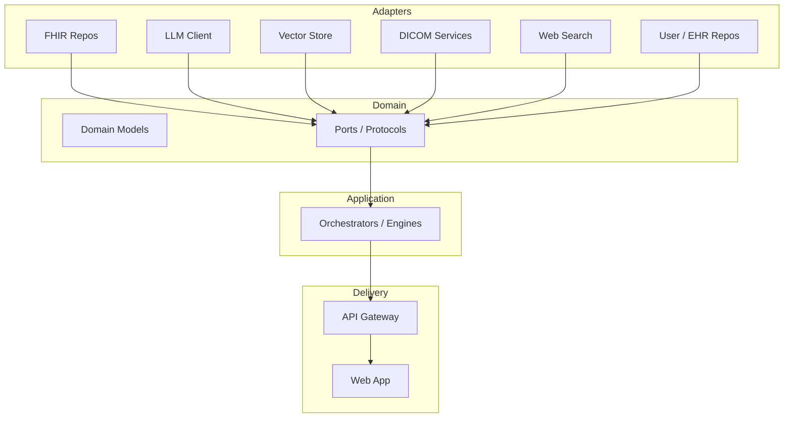

## Executive Summary
CLARA uses a hexagonal architecture to separate the domain from infrastructure. The core defines domain models and ports (interfaces). Adapters implement ports for concrete tech (FHIR, pgvector, OpenAI, DICOM, web search). Orchestrators compose ports to implement flows without knowing infrastructure details.

## Why Hexagonal
- Testability: domain logic can run with in-memory or fake adapters.
- Interchangeability: swap LLM vendor, FHIR repo, or vector store without changing core flows.
- Separation of concerns: domain rules isolated from I/O and frameworks.

## Layers and Boundaries
- Domain: `src/optimed/core/domain/*`
- Ports: `src/optimed/core/ports.py`
- Application/Orchestration: `src/optimed/apps/orchestrator/*`
- Adapters: `src/optimed/adapters/*`
- Delivery: `src/optimed/apps/api_gateway/main.py`, `src/optimed/apps/web`

## Domain Models (selected)
- `PatientContext`: normalized view of EHR data (demographics, vitals, labs, imaging, timelines, sources).
- `ChatMessage`, `ChatRole`: structured messages with roles and metadata.
- `DiagnosisResult` and differential entries: primary and alternative diagnoses with confidence and reasoning.
- `DICOMImage`, `DICOMMetadata`, `ImagePixelData`: imaging entities and processed data.
- `User`, `UserSession`, `UserEHRConnection`: authentication and EHR-scoped access.
- `JournalEntry`, `JournalEntryCreate`, `JournalEntryUpdate`: clinical documentation artifacts.

## Ports (key protocols in `core/ports.py`)
- `FHIRRepository`: async methods for `get_patient`, `search_patients`, and journal CRUD against FHIR.
- `LLMClient`: `chat` and `chat_stream` for text reasoning.
- `VisionLLMClient`: `analyze_dicom_image` for image+text prompts.
- `VectorStore`: embeddings upsert/search and rich chat-session APIs (create, list, participants, messages).
- `ImageService` + `ImageStorage` + `DICOMProcessor`: upload, metadata/pixel extraction, windowing, and storage.
- `UserRepository`, `UserEHRConnectionRepository`: users, sessions, and SMART connections including temporary login sessions.
- `WebSearchService`: `search` and `evaluate_search_need` to integrate external knowledge.
- `ImageGenerationService` and `GeneratedImageRepository`: optional educational image generation and persistence.

## Adapters (examples)
- FHIR: `HAPIFHIRRepository` (default), `SMARTFHIRRepository` (per-user authenticated).
- LLM: `OpenAIGPT4oClient` (chat + streaming + DICOM vision prompts).
- Vector: `PGVectorAdapter` (PostgreSQL + pgvector).
- DICOM: `PyDICOMProcessor`, `FileSystemImageStorage`, `PostgreSQLImageRepository`.
- Web Search: `TavilyWebSearchService`.
- Users/EHR: `PGUserRepository`, `PGUserEHRConnectionRepository`.

## Wiring (Factory)
`src/optimed/apps/orchestrator/factory.py` composes the system:
- Creates repos/services using env vars (DSNs, API keys).
- Selects default FHIR repo (HAPI) and builds SMART service for per-user repos.
- Instantiates engines with the chosen ports (LLM, vector, FHIR, web search, etc.).

## How Orchestrators Use Ports
- Diagnostic flow (`patient_flow.py`): retrieves patient context, evaluates web search need, optionally fetches sources, performs reasoning with LLM, emits streaming updates, stores sessions/history in vector store.
- Information flow (`info_flow.py`): similar flow but optimized for general clinical information; includes cross-session retrieval and optional image generation.
- Image analysis (`image_flow.py`): converts pixel data, formats metadata and patient context, calls `VisionLLMClient`.

## Testing Strategy
- Replace adapters with fakes/mocks in tests; run orchestrators against in-memory stores.
- Contract tests for adapter implementations to meet port behaviors.

Stakeholder Notes
- Ports enforce boundaries so vendor changes (LLM, search, storage) don’t require clinical logic rewrites.

