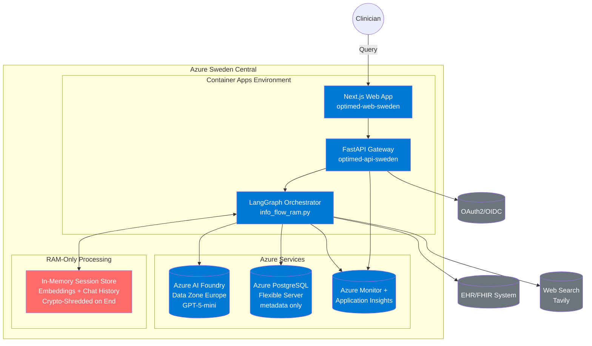
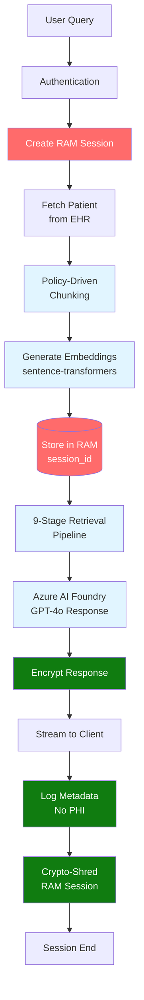

## Executive Summary

CLARA's architecture uses hexagonal (ports-and-adapters) design deployed on **Azure Container Apps** in **Sweden Central** with **Azure AI Foundry (Data Zone Europe)**. The system implements **RAM-only processing** for absolute GDPR compliance, with zero PHI persistence. All patient data and embeddings exist only in volatile memory, automatically zeroized on session end.

## Context Diagram



## Key Architectural Principles

### 1. RAM-Only Processing (Zero PHI Persistence)
- **All patient data**: Processed in volatile memory only
- **All embeddings**: Generated and stored in RAM, never database
- **Session memory**: Encrypted in-memory, crypto-shredded on logout
- **GDPR compliance**: Instant "right to erasure" via memory wipe

### 2. Azure-Native Deployment
- **Region**: Sweden Central (EU data residency)
- **Compute**: Azure Container Apps (serverless, auto-scaling)
- **AI**: Azure AI Foundry - Data Zone Europe
- **Database**: Azure PostgreSQL Flexible Server (metadata only)
- **Monitoring**: Azure Monitor + Application Insights

### 3. Hexagonal Architecture
- **Core Domain**: Business logic independent of infrastructure
- **Ports**: Abstract interfaces (FHIRRepository, LLMClient, etc.)
- **Adapters**: Concrete implementations (Azure OpenAI, HAPI FHIR, etc.)
- **Dependency Injection**: FastAPI with explicit dependency wiring

### 4. GDPR Compliance by Design
- **Data Minimization**: Only metadata persisted
- **Purpose Limitation**: Session-specific processing
- **Storage Limitation**: Automatic deletion on session end
- **Security**: E2E encryption, complete audit trails
- **Transparency**: Full data lineage tracking

---

## Component Architecture

### API Gateway (`src/optimed/apps/api_gateway/main.py`)

**FastAPI application** serving RESTful endpoints:

**Endpoints**:
- `/api/v1/chat` - Streaming chat interface
- `/api/v1/patients/{id}` - Patient context retrieval
- `/api/v1/sessions` - Session management
- `/api/v1/health` - Health checks
- `/auth/*` - OAuth2/OIDC authentication

**Responsibilities**:
- Request validation (Pydantic)
- Authentication/authorization
- Rate limiting
- CORS handling
- Dependency injection
- Error handling

**Azure Integration**:
- Azure Monitor telemetry
- Application Insights tracing
- Managed identity for service auth

---

### Orchestrator (`src/optimed/apps/orchestrator/`)

**Primary Flow**: `info_flow_ram.py` - LangGraph-based information retrieval

**Key Features**:
- Zero-shot query classification
- 9-stage intelligent retrieval pipeline
- Specialized flows (SBAR, Summary, Timeline, Notes)
- Agentic refinement loop
- RAM-only session memory
- Parallel execution for multi-component flows

**Orchestrator Components**:
```
info_flow_ram.py          # PRIMARY - Information retrieval
patient_flow.py           # DEPRECATED - Legacy diagnostic
chunking_orchestrator.py  # Policy-driven document chunking
```

**Flow Types**:
1. **Standard Flow**: Query → Retrieval → LLM → Response
2. **SBAR Flow**: 4 parallel components (300-500ms)
3. **Summary Flow**: 8 parallel components (500-800ms)
4. **Timeline Flow**: Event extraction + retrieval
5. **Note Generation**: Template-driven documentation

---

### Core Domain (`src/optimed/core/domain/`)

**Business Entities**:
- `Patient` - Patient demographic and clinical data
- `User` - System users with roles and permissions
- `ChatMessage` - Conversation history
- `ClinicalData` - Observations, conditions, procedures
- `Session` - User session with encryption context
- `AuditEvent` - Compliance logging events

**Domain Logic**:
- Clinical data validation
- PHI detection and redaction
- Session lifecycle management
- Data quality scoring

---

### Ports (`src/optimed/core/ports.py`)

**Abstract Interfaces** defining contracts:

```python
class FHIRRepository(ABC):
    """EHR data access"""
    async def get_patient_context(patient_id: str) -> PatientContext

class LLMClient(ABC):
    """AI model interactions"""
    async def chat(messages: List[ChatMessage]) -> ChatMessage
    async def stream_chat(messages) -> AsyncGenerator[str]

class VectorStore(ABC):
    """Embedding storage (RAM-only)"""
    async def store_embeddings(session_id: str, chunks, embeddings)
    async def search(session_id: str, query_embedding) -> List[Chunk]

class UserRepository(ABC):
    """User management"""
    async def get_user_by_id(user_id: str) -> User
    async def log_audit_event(event: AuditEvent)

class WebSearchService(ABC):
    """External search"""
    async def search(query: str) -> WebSearchResponse
```

---

### Adapters (`src/optimed/adapters/`)

**External System Integrations**:

#### AI/ML Adapters
- **`openai_gpt/`** - **PRIMARY**: Azure OpenAI (AI Foundry)
  - `AzureOpenAIClient` with managed identity support
  - Streaming and non-streaming completion
  - Rate limiting and retry logic
- **`anthropic_claude/`** - Alternative: Claude AI
- **`embeddings/minilm.py`** - sentence-transformers (384-dim)
- **Cross-encoder** - Multilingual reranking
- **Zero-shot classifier** - Query intent detection

#### Data Adapters
- **`fhir_hapi/`** - HAPI FHIR server integration
- **`smart_fhir/`** - SMART-on-FHIR with OAuth2
- **`vectorstores/pgvector.py`** - RAM-only vector store (no persistence)
- **`outbound/phi_redactor/`** - PHI detection and redaction

#### Infrastructure Adapters
- **`security/`** - E2E encryption, crypto-shredding
- **`chunking/`** - Document chunking strategies
- **`outbound/tokenizer/`** - Text tokenization
- **`repositories/`** - Database repositories (metadata only)

---

## Data Flow (RAM-Only Architecture)



**Key Points**:
1. Patient data fetched from EHR (never persisted)
2. Embeddings generated in RAM only
3. Retrieval pipeline operates on in-memory data
4. LLM response encrypted and streamed
5. Audit logs contain metadata only (no PHI)
6. Session memory crypto-shredded on logout

---

## Cross-Cutting Concerns

### Security & Privacy

**Authentication**:
- OAuth2/OIDC via Azure AD
- SMART-on-FHIR for EHR access
- Per-user EHR connections
- Role-based access control (RBAC)

**Encryption**:
- **E2E**: AES-256-GCM with RSA-2048 key exchange
- **Transport**: TLS 1.3
- **At Rest**: Azure-managed encryption
- **Session**: Fernet with TTL-based keys

**Privacy**:
- Zero PHI persistence
- RAM-only embeddings
- Crypto-shredding on logout
- Complete audit trails (metadata only)
- GDPR "right to erasure" instant

### Observability (Azure Monitor)

**Metrics**:
- Request latency (p50, p95, p99)
- Error rates
- Token consumption
- Concurrent sessions
- Memory usage

**Logging**:
- Structured JSON logs
- Azure Log Analytics
- Application Insights traces
- Distributed tracing with correlation IDs

**Alerting**:
- Azure Monitor Alerts
- Action Groups for notifications
- SLA monitoring (99.9% uptime)

**Sample KQL Query**:
```kql
AppRequests
| where TimeGenerated > ago(1h)
| where Url contains "/chat"
| summarize
    AvgDuration = avg(DurationMs),
    P95Duration = percentile(DurationMs, 95),
    RequestCount = count()
by bin(TimeGenerated, 5m)
| render timechart
```

### Internationalization (i18n)

**Language Detection**:
- Automatic language detection from user prompt
- Zero-shot classifier for 100+ languages
- Multilingual cross-encoder reranking

**Response Generation**:
- Language-aware prompts
- Source language preservation
- Multilingual EHR data handling

### Error Handling

**Defensive Design**:
- Try/except at API boundaries
- Partial degradation with defaults
- Graceful fallbacks for retrieval failures
- Retry logic with exponential backoff

**Error Responses**:
```python
{
  "error": "retrieval_failed",
  "message": "Could not retrieve patient context",
  "details": "FHIR server timeout",
  "request_id": "abc-123",
  "timestamp": "2025-01-27T10:30:00Z"
}
```

---

## Deployment Architecture

### Azure Resources (Sweden Central)

```
Resource Group: optimed-sweden-rg
├─ Container Apps Environment: optimed-env-sweden
│  ├─ optimed-api-sweden (Backend)
│  │  ├─ Min replicas: 1
│  │  ├─ Max replicas: 5
│  │  ├─ CPU: 1.0 core
│  │  └─ Memory: 2Gi
│  └─ optimed-web-sweden (Frontend)
│     ├─ Min replicas: 1
│     ├─ Max replicas: 3
│     ├─ CPU: 0.5 core
│     └─ Memory: 1Gi
├─ Azure AI Foundry: optimed-ai-sweden
│  ├─ Model: gpt-4o
│  ├─ TPM: 50,000
│  └─ Data Zone: Europe
├─ PostgreSQL Flexible Server: optimed-db-sweden
│  ├─ SKU: Standard_D2s_v3
│  ├─ Storage: 128GB
│  └─ Extensions: pgcrypto, vector
├─ Container Registry: optimedacr123.azurecr.io
├─ Log Analytics Workspace: optimed-logs
└─ Application Insights: optimed-insights
```

### Scaling Strategy

**Auto-Scaling Rules**:
- CPU > 70%: Scale up
- Memory > 80%: Scale up
- Request queue > 100: Scale up
- CPU < 30% for 5min: Scale down

**Performance**:
- Single replica: 100+ concurrent sessions
- Memory per session: 1-2MB
- Retrieval latency: 300-800ms
- Time to first token: <1s

---

## Technology Stack

### Backend
- **Language**: Python 3.12
- **Framework**: FastAPI
- **Orchestration**: LangGraph
- **AI SDK**: Azure OpenAI SDK
- **Database**: asyncpg (PostgreSQL)
- **Embeddings**: sentence-transformers
- **ML**: transformers, scikit-learn

### Frontend
- **Framework**: Next.js 15 (React)
- **Language**: TypeScript
- **UI**: Tailwind CSS, Radix UI
- **Streaming**: Server-Sent Events
- **Encryption**: Web Crypto API

### Infrastructure
- **Cloud**: Azure (Sweden Central)
- **Compute**: Azure Container Apps
- **Database**: Azure PostgreSQL Flexible Server
- **AI**: Azure AI Foundry (Data Zone Europe)
- **Monitoring**: Azure Monitor, Application Insights
- **Registry**: Azure Container Registry

---

## Assumptions and Constraints

### Assumptions
- EHR connectivity via FHIR R4 (HAPI or SMART-on-FHIR)
- Internet connectivity required (no offline mode)
- Azure subscription with appropriate quotas
- EU data residency requirement
- GDPR compliance mandatory

### Constraints
- **Region**: Must deploy in Sweden Central for data residency
- **AI**: Must use Azure AI Foundry Data Zone Europe
- **Memory**: RAM-only processing limits session data size
- **Latency**: Sub-second retrieval requires optimization
- **Cost**: Token consumption must be monitored

---

## Stakeholder Notes

### For Clinical Leadership
- CLARA assists clinicians but does not replace clinical judgment
- All information includes EHR source links for verification
- Complete audit trail for medical-legal compliance
- GDPR compliance ensures patient privacy

### For IT Leadership
- Serverless deployment with auto-scaling (1-5 replicas)
- Zero infrastructure for vector database (RAM-only)
- Managed services reduce operational overhead
- Comprehensive monitoring via Azure Monitor

### For Compliance Officers
- **Zero PHI Persistence**: Instant GDPR compliance
- **EU Data Residency**: All processing within EU
- **Complete Audit Trail**: 7-year metadata retention
- **Data Lineage**: Full transformation tracking

### For Security Teams
- E2E encryption for all sessions
- Managed identity (no API keys in code)
- Private endpoints for database
- Regular security audits

---

## Related Documentation

- [Data Flow](data_flow.md) - Detailed RAM-only processing
- [Deployment](deployment.md) - Azure Container Apps configuration
- [GDPR Architecture](gdpr_compliant_architecture.md) - Privacy design
- [Hexagonal Architecture](hexagonal_architecture.md) - Domain design
- [Intelligent Retrieval](../algorithms/intelligent_retrieve_chunks.md) - Algorithm details

---

**Version**: 2.0.0 (RAM-Only Architecture)
**Last Updated**: 2025-01-27
**Deployment**: Azure Sweden Central (EU)
**LLM Provider**: Azure AI Foundry - Data Zone Europe
