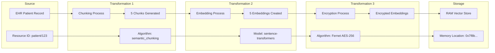

## Executive Summary

This document provides a comprehensive guide to data traceability, usage analytics, and audit capabilities in OptiMed AI. The system implements extensive logging and monitoring to ensure complete transparency, regulatory compliance, and operational insights while maintaining GDPR compliance and patient privacy.

## Data Flow Architecture

### Overview of Data Movement

OptiMed AI processes data through multiple layers with comprehensive tracking at each stage:

```mermaid
graph TB
    subgraph "Data Sources"
        EHR[EHR Systems]
        WEB[Web Search]
        USER[User Input]
        FILES[File Uploads]
    end

    subgraph "Ingestion Layer"
        API[API Gateway]
        AUTH[Authentication]
        VAL[Validation]
    end

    subgraph "Processing Layer"
        ORCH[Orchestrator]
        ML[ML Models]
        CHUNK[Chunking Engine]
        EMBED[Embedding Engine]
    end

    subgraph "Security Layer"
        ENCRYPT[Encryption Service]
        AUDIT[Audit Logger]
        GDPR[GDPR Compliance]
    end

    subgraph "Storage Layer"
        RAM[RAM Vector Store]
        DB[Database (Metadata Only)]
        LOGS[Audit Logs]
    end

    subgraph "Output Layer"
        RESP[Response Generation]
        STREAM[Streaming Output]
        EXPORT[Data Export]
    end

    EHR --> API
    WEB --> API
    USER --> API
    FILES --> API

    API --> AUTH
    AUTH --> VAL
    VAL --> ORCH

    ORCH --> ML
    ORCH --> CHUNK
    ORCH --> EMBED

    ML --> ENCRYPT
    CHUNK --> AUDIT
    EMBED --> GDPR

    ENCRYPT --> RAM
    AUDIT --> DB
    GDPR --> LOGS

    RAM --> RESP
    DB --> STREAM
    LOGS --> EXPORT

    classDef sensitive fill:#ffcccc
    classDef secure fill:#ccffcc
    classDef storage fill:#ccccff

    class EHR,USER,FILES sensitive
    class ENCRYPT,AUDIT,GDPR secure
    class RAM,DB,LOGS storage
```

### Data Processing Stages

#### 1. **Data Ingestion**
- **Sources**: EHR systems, user input, web search, file uploads
- **Processing**: Authentication, validation, sanitization
- **Logging**: All ingestion events logged with source, size, timestamp
- **Compliance**: GDPR lawful basis recorded, consent status tracked

#### 2. **Data Transformation**
- **Operations**: Chunking, embedding, encryption, anonymization
- **Processing**: AI model inference, content analysis
- **Logging**: Each transformation step logged with algorithm, duration, quality metrics
- **Compliance**: Data minimization applied, retention policies enforced

#### 3. **Data Storage**
- **RAM Only**: Patient content, embeddings (never persisted)
- **Database**: Metadata, audit trails, compliance records
- **Logging**: All storage operations logged with location, encryption status
- **Compliance**: PHI never stored, crypto-shredding for immediate deletion

#### 4. **Data Output**
- **Formats**: JSON responses, streaming output, exported reports
- **Processing**: Response generation, formatting, encryption
- **Logging**: All outputs logged with recipient, content hash, delivery status
- **Compliance**: Data subject rights respected, audit trail maintained

## Comprehensive Logging System

### 1. System Usage Metrics

Tracks overall system usage patterns for capacity planning and analytics:

```sql
-- Example usage metrics
SELECT
    metric_type,
    metric_name,
    SUM(value) as total_value,
    AVG(value) as avg_value,
    COUNT(*) as occurrence_count
FROM system_usage_metrics
WHERE recorded_at >= NOW() - INTERVAL '24 hours'
GROUP BY metric_type, metric_name
ORDER BY total_value DESC;
```

**Tracked Metrics:**
- API call frequencies and patterns
- Model inference counts and durations
- Data processing volumes
- User activity levels
- System resource utilization

### 2. Session Analytics

Provides detailed insights into user sessions:

```sql
-- Session performance overview
SELECT
    user_role,
    AVG(session_duration_minutes) as avg_duration,
    AVG(total_requests) as avg_requests,
    AVG(patient_contexts_accessed) as avg_patients,
    SUM(error_count) as total_errors
FROM session_analytics sa
JOIN sessions s ON sa.session_id = s.session_id
WHERE s.started_at >= NOW() - INTERVAL '7 days'
GROUP BY user_role;
```

**Tracked Data:**
- Session duration and activity levels
- Request/response patterns
- Patient context access patterns
- Feature usage (diagnostics, chat, search)
- Error rates and types

### 3. Data Access Logging

Complete audit trail of all data access for GDPR compliance:

```sql
-- Data access patterns by user role
SELECT
    u.role,
    dal.data_source,
    dal.resource_type,
    COUNT(*) as access_count,
    AVG(dal.access_duration_ms) as avg_duration
FROM data_access_logs dal
JOIN sessions s ON dal.session_id = s.session_id
JOIN users u ON s.user_id = u.user_id
WHERE dal.accessed_at >= NOW() - INTERVAL '30 days'
GROUP BY u.role, dal.data_source, dal.resource_type
ORDER BY access_count DESC;
```

**Tracked Information:**
- Who accessed what data when
- Legal basis for each access
- Purpose of data use
- Retention periods applied
- Encryption methods used

### 4. Performance Metrics

Detailed performance monitoring for optimization:

```sql
-- Response time analysis
SELECT
    endpoint,
    metric_name,
    AVG(value) as avg_latency_ms,
    PERCENTILE_CONT(0.95) WITHIN GROUP (ORDER BY value) as p95_latency,
    MAX(value) as max_latency
FROM performance_metrics
WHERE metric_category = 'latency'
AND measured_at >= NOW() - INTERVAL '1 hour'
GROUP BY endpoint, metric_name
ORDER BY avg_latency_ms DESC;
```

**Tracked Metrics:**
- Response times and throughput
- Model inference performance
- Database query performance
- Memory and CPU utilization
- Network latency and bandwidth

### 5. Encryption Audit Trail

Security-focused logging of all encryption operations:

```sql
-- Encryption operation monitoring
SELECT
    operation_type,
    encryption_algorithm,
    COUNT(*) as operation_count,
    AVG(operation_duration_ms) as avg_duration,
    SUM(CASE WHEN success THEN 1 ELSE 0 END) * 100.0 / COUNT(*) as success_rate
FROM encryption_audit_log
WHERE performed_at >= NOW() - INTERVAL '24 hours'
GROUP BY operation_type, encryption_algorithm
ORDER BY operation_count DESC;
```

**Tracked Operations:**
- Key generation and rotation
- Encrypt/decrypt operations
- Algorithm usage patterns
- Success/failure rates
- Performance impact

### 6. Compliance Events

Regulatory compliance tracking and reporting:

```sql
-- Compliance status overview
SELECT
    compliance_framework,
    event_type,
    compliance_status,
    COUNT(*) as event_count
FROM compliance_events
WHERE occurred_at >= NOW() - INTERVAL '30 days'
GROUP BY compliance_framework, event_type, compliance_status
ORDER BY event_count DESC;
```

**Tracked Events:**
- GDPR data subject requests
- Consent management
- Data retention compliance
- Cross-border data transfers
- Privacy impact assessments

## Data Lineage Tracking

### Lineage Data Model

OptiMed tracks complete data lineage for transparency and debugging:



### Lineage Query Examples

**Track data from source to destination:**
```sql
-- Complete lineage for a session
WITH RECURSIVE lineage_tree AS (
    -- Base case: start with source data
    SELECT
        id,
        session_id,
        source_system,
        source_resource_id,
        transformation_type,
        destination_system,
        parent_lineage_id,
        0 as depth
    FROM data_lineage
    WHERE session_id = $1 AND parent_lineage_id IS NULL

    UNION ALL

    -- Recursive case: follow transformations
    SELECT
        dl.id,
        dl.session_id,
        dl.source_system,
        dl.source_resource_id,
        dl.transformation_type,
        dl.destination_system,
        dl.parent_lineage_id,
        lt.depth + 1
    FROM data_lineage dl
    JOIN lineage_tree lt ON dl.parent_lineage_id = lt.id
)
SELECT * FROM lineage_tree ORDER BY depth, id;
```

**Find data quality issues:**
```sql
-- Identify low-quality transformations
SELECT
    session_id,
    transformation_type,
    processing_algorithm,
    AVG(quality_score) as avg_quality,
    COUNT(*) as transformation_count
FROM data_lineage
WHERE created_at >= NOW() - INTERVAL '7 days'
AND quality_score < 0.8
GROUP BY session_id, transformation_type, processing_algorithm
ORDER BY avg_quality ASC;
```

## GDPR Compliance Features

### Data Subject Rights Management

#### Right to Access
```sql
-- Generate data subject access report
SELECT
    'Session Data' as data_category,
    s.session_id,
    s.started_at,
    s.ended_at,
    sa.total_requests,
    sa.patient_contexts_accessed
FROM sessions s
LEFT JOIN session_analytics sa ON s.session_id = sa.session_id
WHERE s.subject_hash = digest($1, 'sha256')
AND s.started_at >= NOW() - INTERVAL '3 years'

UNION ALL

SELECT
    'Audit Events' as data_category,
    ae.session_id::text,
    ae.occurred_at,
    NULL,
    NULL,
    NULL
FROM audit_events ae
JOIN sessions s ON ae.session_id = s.session_id
WHERE s.subject_hash = digest($1, 'sha256')
AND ae.occurred_at >= NOW() - INTERVAL '3 years';
```

#### Right to Erasure
```sql
-- Implement right to erasure (crypto-shredding)
BEGIN;
-- Delete session keys (crypto-shredding)
DELETE FROM session_encryption_keys
WHERE session_id IN (
    SELECT session_id FROM sessions
    WHERE subject_hash = digest($1, 'sha256')
);

-- Mark sessions as erased
UPDATE sessions
SET ended_at = NOW(),
    lawful_basis = 'erased_by_request'
WHERE subject_hash = digest($1, 'sha256');

-- Log the erasure event
INSERT INTO compliance_events (
    event_type, compliance_framework, user_id, patient_id,
    lawful_basis, individual_rights_exercised
) VALUES (
    'data_erasure', 'GDPR', $2, $1,
    'right_to_erasure', ARRAY['erasure']
);
COMMIT;
```

#### Right to Portability
```sql
-- Generate portable data export
SELECT jsonb_build_object(
    'patient_id', $1,
    'export_date', NOW(),
    'data_retention_notice', 'This data will be retained according to medical record retention policies',
    'sessions', jsonb_agg(
        jsonb_build_object(
            'session_id', s.session_id,
            'start_time', s.started_at,
            'end_time', s.ended_at,
            'lawful_basis', s.lawful_basis,
            'purpose', s.purpose_of_use,
            'analytics', jsonb_build_object(
                'duration_minutes', sa.session_duration_minutes,
                'total_requests', sa.total_requests,
                'diagnostic_requests', sa.diagnostic_requests
            )
        )
    )
) as portable_data
FROM sessions s
LEFT JOIN session_analytics sa ON s.session_id = sa.session_id
WHERE s.subject_hash = digest($1, 'sha256')
GROUP BY true;
```

### Privacy by Design Implementation

#### Data Minimization
- **Collection**: Only necessary data is collected for specific purposes
- **Processing**: Data is processed using privacy-preserving techniques
- **Storage**: PHI is never stored persistently, only metadata
- **Retention**: Automatic deletion based on configurable retention policies

#### Purpose Limitation
- **Session Tracking**: Each session records its specific purpose
- **Access Control**: Data access is limited to authorized purposes
- **Audit Trail**: All purposes are logged and auditable
- **Consent Management**: User consent is tracked per purpose

#### Transparency
- **Data Mapping**: Complete mapping of all data flows
- **Processing Records**: Detailed records of all processing activities
- **User Interfaces**: Clear information about data use
- **Audit Reports**: Comprehensive audit trails for regulators

## Usage Analytics and Insights

### Operational Dashboards

#### System Health Dashboard
```sql
-- Key performance indicators
SELECT
    'Active Sessions' as metric,
    COUNT(*) as value,
    'count' as unit
FROM sessions
WHERE ended_at IS NULL

UNION ALL

SELECT
    'Average Response Time' as metric,
    AVG(value) as value,
    'milliseconds' as unit
FROM performance_metrics
WHERE metric_name = 'response_time'
AND measured_at >= NOW() - INTERVAL '1 hour'

UNION ALL

SELECT
    'Encryption Success Rate' as metric,
    AVG(CASE WHEN success THEN 100.0 ELSE 0.0 END) as value,
    'percentage' as unit
FROM encryption_audit_log
WHERE performed_at >= NOW() - INTERVAL '1 hour';
```

#### User Activity Analytics
```sql
-- User behavior insights
SELECT
    u.role as user_role,
    COUNT(DISTINCT s.session_id) as total_sessions,
    AVG(sa.session_duration_minutes) as avg_session_duration,
    SUM(sa.diagnostic_requests) as total_diagnostics,
    SUM(sa.chat_requests) as total_chats,
    AVG(sa.patient_contexts_accessed) as avg_patients_per_session
FROM users u
JOIN sessions s ON u.user_id = s.user_id
JOIN session_analytics sa ON s.session_id = sa.session_id
WHERE s.started_at >= NOW() - INTERVAL '30 days'
GROUP BY u.role
ORDER BY total_sessions DESC;
```

#### Compliance Monitoring
```sql
-- GDPR compliance metrics
SELECT
    DATE_TRUNC('week', occurred_at) as week,
    COUNT(*) as total_events,
    COUNT(*) FILTER (WHERE compliance_status = 'compliant') as compliant_events,
    COUNT(*) FILTER (WHERE compliance_status = 'non_compliant') as non_compliant_events,
    COUNT(*) FILTER (WHERE event_type = 'data_access') as data_access_events,
    COUNT(*) FILTER (WHERE event_type = 'consent_given') as consent_events
FROM compliance_events
WHERE occurred_at >= NOW() - INTERVAL '12 weeks'
GROUP BY DATE_TRUNC('week', occurred_at)
ORDER BY week DESC;
```

### Predictive Analytics

#### Capacity Planning
```sql
-- Predict future capacity needs
WITH hourly_usage AS (
    SELECT
        DATE_TRUNC('hour', recorded_at) as hour,
        SUM(value) as requests_per_hour
    FROM system_usage_metrics
    WHERE metric_type = 'api_call'
    AND recorded_at >= NOW() - INTERVAL '30 days'
    GROUP BY DATE_TRUNC('hour', recorded_at)
),
usage_trends AS (
    SELECT
        hour,
        requests_per_hour,
        AVG(requests_per_hour) OVER (
            ORDER BY hour
            ROWS BETWEEN 23 PRECEDING AND CURRENT ROW
        ) as rolling_24h_avg
    FROM hourly_usage
)
SELECT
    hour,
    requests_per_hour,
    rolling_24h_avg,
    CASE
        WHEN rolling_24h_avg > LAG(rolling_24h_avg, 24) OVER (ORDER BY hour) * 1.1
        THEN 'Growing'
        WHEN rolling_24h_avg < LAG(rolling_24h_avg, 24) OVER (ORDER BY hour) * 0.9
        THEN 'Declining'
        ELSE 'Stable'
    END as trend
FROM usage_trends
WHERE hour >= NOW() - INTERVAL '7 days'
ORDER BY hour DESC;
```

#### Anomaly Detection
```sql
-- Detect unusual usage patterns
WITH baseline AS (
    SELECT
        metric_type,
        metric_name,
        AVG(value) as baseline_avg,
        STDDEV(value) as baseline_stddev
    FROM system_usage_metrics
    WHERE recorded_at >= NOW() - INTERVAL '30 days'
    AND recorded_at < NOW() - INTERVAL '1 day'
    GROUP BY metric_type, metric_name
),
recent_activity AS (
    SELECT
        metric_type,
        metric_name,
        AVG(value) as recent_avg
    FROM system_usage_metrics
    WHERE recorded_at >= NOW() - INTERVAL '1 hour'
    GROUP BY metric_type, metric_name
)
SELECT
    ra.metric_type,
    ra.metric_name,
    ra.recent_avg,
    b.baseline_avg,
    ABS(ra.recent_avg - b.baseline_avg) / NULLIF(b.baseline_stddev, 0) as z_score,
    CASE
        WHEN ABS(ra.recent_avg - b.baseline_avg) / NULLIF(b.baseline_stddev, 0) > 3
        THEN 'ANOMALY'
        WHEN ABS(ra.recent_avg - b.baseline_avg) / NULLIF(b.baseline_stddev, 0) > 2
        THEN 'WARNING'
        ELSE 'NORMAL'
    END as alert_level
FROM recent_activity ra
JOIN baseline b ON ra.metric_type = b.metric_type AND ra.metric_name = b.metric_name
WHERE b.baseline_stddev > 0
ORDER BY z_score DESC;
```

## API Integration for Monitoring

### Real-Time Metrics API

```python
from fastapi import APIRouter, Depends, Query
from typing import Optional, List
import asyncio

router = APIRouter(prefix="/api/v1/metrics", tags=["metrics"])

@router.get("/usage/realtime")
async def get_realtime_usage_metrics(
    metric_types: Optional[List[str]] = Query(None),
    last_minutes: int = Query(5, ge=1, le=60),
    user_repo: UserRepository = Depends(get_user_repository)
):
    """Get real-time usage metrics for monitoring dashboards."""

    # Log the metrics request
    await user_repo.log_system_usage_metric(
        metric_type="api_call",
        metric_name="metrics_realtime_request",
        value=1,
        dimensions={
            "metric_types": metric_types,
            "time_window_minutes": last_minutes
        }
    )

    # Get metrics (implementation would query the database)
    metrics = await get_realtime_metrics(metric_types, last_minutes)

    return {
        "timestamp": datetime.utcnow().isoformat(),
        "time_window_minutes": last_minutes,
        "metrics": metrics
    }

@router.get("/compliance/status")
async def get_compliance_status(
    framework: str = Query("GDPR"),
    days: int = Query(30, ge=1, le=365),
    user_repo: UserRepository = Depends(get_user_repository)
):
    """Get compliance status overview."""

    # Log compliance status request
    await user_repo.log_compliance_event(
        event_type="compliance_status_request",
        compliance_framework=framework,
        user_id=get_current_user().user_id,
        lawful_basis="legitimate_interest",
        processing_purposes=["compliance_monitoring"]
    )

    # Get compliance metrics
    status = await get_compliance_status(framework, days)

    return {
        "framework": framework,
        "period_days": days,
        "status": status,
        "generated_at": datetime.utcnow().isoformat()
    }
```

### Automated Reporting

```python
async def generate_daily_compliance_report():
    """Generate daily compliance report with key metrics."""

    report_data = {
        "report_date": datetime.utcnow().date().isoformat(),
        "system_metrics": await get_system_health_summary(),
        "compliance_metrics": await get_compliance_summary(),
        "security_metrics": await get_security_summary(),
        "performance_metrics": await get_performance_summary()
    }

    # Log report generation
    await user_repo.log_system_usage_metric(
        metric_type="reporting",
        metric_name="daily_compliance_report_generated",
        value=1,
        dimensions={
            "report_type": "compliance",
            "automated": True
        }
    )

    return report_data

async def export_audit_trail(start_date: datetime, end_date: datetime,
                           export_format: str = "json"):
    """Export complete audit trail for compliance purposes."""

    audit_data = await get_comprehensive_audit_trail(start_date, end_date)

    # Log export event
    await user_repo.log_compliance_event(
        event_type="audit_trail_export",
        compliance_framework="GDPR",
        user_id=get_current_user().user_id,
        lawful_basis="compliance_obligation",
        processing_purposes=["regulatory_compliance", "audit_trail"],
        data_categories=["audit_logs", "system_metrics"],
        retention_period_days=2555  # 7 years
    )

    if export_format == "json":
        return json.dumps(audit_data, indent=2, default=str)
    elif export_format == "csv":
        return convert_to_csv(audit_data)
    else:
        raise ValueError(f"Unsupported export format: {export_format}")
```

## Operational Procedures

### Daily Monitoring Checklist

1. **System Health**
   - [ ] Check active session count
   - [ ] Verify encryption success rate > 99.9%
   - [ ] Monitor response time averages
   - [ ] Review error rates and patterns

2. **Compliance Status**
   - [ ] Verify all data access is logged
   - [ ] Check GDPR request processing times
   - [ ] Review consent management status
   - [ ] Validate retention policy compliance

3. **Security Monitoring**
   - [ ] Review encryption audit logs
   - [ ] Check for failed authentication attempts
   - [ ] Monitor unusual access patterns
   - [ ] Verify key rotation schedules

4. **Performance Optimization**
   - [ ] Analyze slow query reports
   - [ ] Review memory usage patterns
   - [ ] Check database performance metrics
   - [ ] Monitor API endpoint response times

### Incident Response Procedures

#### Data Breach Response
1. **Immediate Actions** (< 1 hour)
   - Isolate affected systems
   - Activate crypto-shredding for compromised data
   - Document incident timeline
   - Notify security team

2. **Investigation** (< 24 hours)
   - Review audit logs for breach scope
   - Identify affected data subjects
   - Assess regulatory notification requirements
   - Implement additional safeguards

3. **Regulatory Response** (< 72 hours)
   - Prepare breach notification for DPA
   - Notify affected data subjects if required
   - Document remediation measures
   - Update security procedures

#### Performance Degradation
1. **Detection**
   - Automated alerts for response time thresholds
   - Manual monitoring dashboard reviews
   - User-reported issues

2. **Analysis**
   - Review performance metrics
   - Identify bottlenecks using lineage data
   - Check resource utilization patterns

3. **Resolution**
   - Implement immediate mitigations
   - Scale resources if needed
   - Optimize slow operations
   - Document lessons learned

## Conclusion

OptiMed AI's comprehensive data traceability and usage analytics system provides:

### **Complete Transparency**
- Full audit trail of all data operations
- Detailed lineage tracking from source to destination
- Real-time monitoring and alerting capabilities
- Comprehensive compliance reporting

### **Regulatory Compliance**
- GDPR Article 30 processing records
- Data subject rights automation
- Privacy impact assessment support
- Regulatory audit readiness

### **Operational Excellence**
- Performance monitoring and optimization
- Predictive analytics for capacity planning
- Automated anomaly detection
- Comprehensive reporting dashboards

### **Security Assurance**
- Complete encryption operation auditing
- Security incident detection and response
- Access pattern analysis
- Threat intelligence integration

This system ensures that OptiMed AI not only meets current regulatory requirements but is also prepared for future compliance challenges while providing the operational insights needed for continuous improvement and optimization.

The combination of technical controls, comprehensive logging, and automated compliance processes positions OptiMed AI as a leader in responsible healthcare AI, demonstrating that privacy protection and system functionality can coexist successfully.