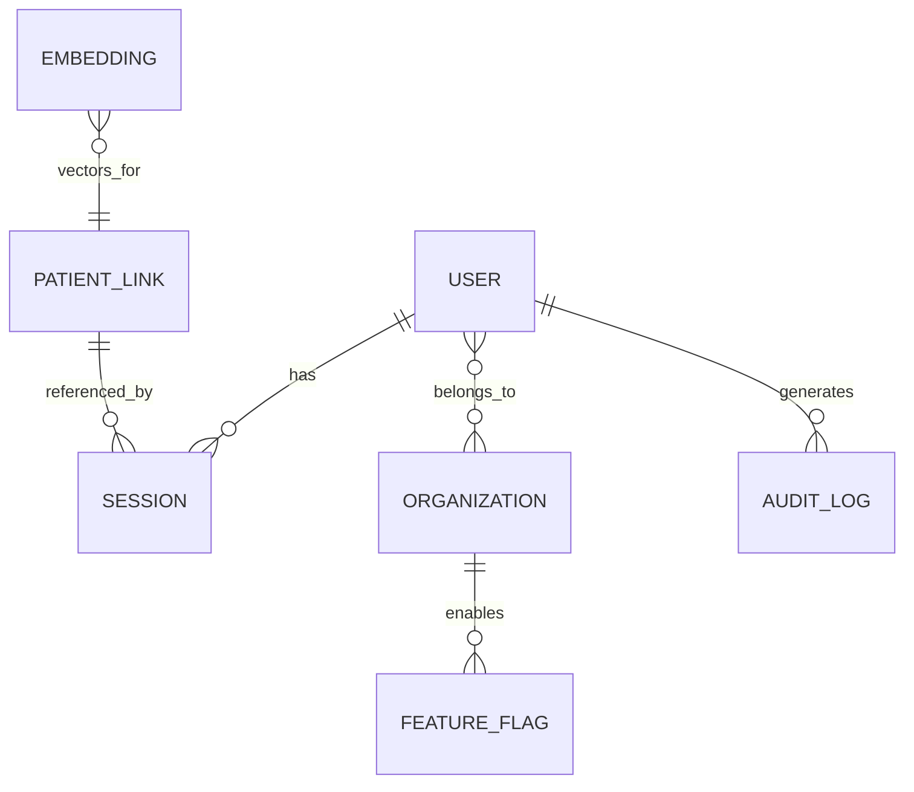

## Executive Summary
PostgreSQL with pgvector backs chat sessions, history, embeddings, user accounts, and generated images metadata. This doc provides an ER scaffold and notes on migrations and PII minimization.

## Storage Choices
- PostgreSQL + pgvector: vector search and relational data
- Object storage: raw DICOM files and rendered PNGs

## ER Diagram (scaffold)

Assumptions
- Vector rows store `embedding vector`, `object_type`, `object_id`, `metadata` JSONB.
- Sessions track participants and message counts.

Migrations
- Use Alembic or SQL migrations; require approvals in CI/CD.

PII Minimization
- Store only necessary identifiers; prefer hashed or pseudonymized IDs for logs.
- Encrypt at rest; restrict access with least privilege.

Stakeholder Notes
- Ensure DPIA reflects purposes for each table containing PHI.

